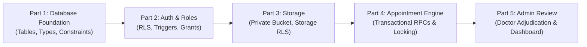

# VoiceCare Phase 2 — Database Architecture & Security Review

This directory contains the database design artifacts, SQL migration specifications, and static verification suites for **Phase 2 of the VoiceCare platform**.

> [!WARNING]
> **REVIEW ARTIFACTS ONLY — NOT EXECUTED IN SUPABASE**
> - All SQL scripts and architectural designs in this directory represent **approved review specifications only**.
> - **No SQL has been executed in Supabase** or any live, staging, or production database.
> - These artifacts must **not** be described or deployed as production-ready without integrated end-to-end sandbox testing.

---

## 1. Project Context & Purpose of Phase 2

**VoiceCare** is an AI-assisted, multilingual, voice-first healthcare appointment booking application engineered for India's diverse linguistic and clinical landscape.

- **Phase 1 (Complete):** High-fidelity multilingual frontend prototype supporting real-time voice workflows, doctor discovery, slot selection, and appointment confirmations.
- **Phase 2 (In Development):** Comprehensive backend data layer on **Supabase** (PostgreSQL 15+, Supabase Auth, Supabase Storage, and PostgREST Data API), divided into seven modular parts:
  - **Part 1:** Core Database Foundation *(included)*
  - **Part 2:** Authentication and Roles *(included)*
  - **Part 3:** Supabase Storage and Doctor Verification Documents *(included)*
  - **Part 4:** Appointment Engine and Doctor Onboarding RPCs *(included)*
  - **Part 5:** Admin Review Dashboard & Verification Workflows *(included)*
  - **Part 6:** Audit Logging, Telemetry & Compliance *(upcoming)*
  - **Part 7:** Integrated End-to-End Migration & Verification *(upcoming)*

This branch (`phase-2-review`) publishes **Parts 1 through 5** for architectural review and security auditing.

---

## 2. Directory Structure & Included Artifacts

The review files are organized modularly:

```text
docs/phase-2/
├── README.md                                    # This review overview document
├── verify_all_phase2.py                         # Master static verification suite for Parts 1–4
│
├── part-1-database-foundation/
│   ├── voicecare_part1_database.sql             # Schema DDL, constraints, domains, indexes
│   ├── voicecare_part1_database_design.md       # Architectural specification & schema rationale
│   └── voicecare_part1_database_notes.md        # Technical implementation & constraint notes
│
├── part-2-authentication-roles/
│   ├── voicecare_part2_auth.sql                 # Row Level Security (RLS) policies, triggers, grants
│   ├── voicecare_part2_auth_design.md           # Role-based access control & security model
│   └── voicecare_part2_auth_notes.md            # Auth lifecycle & least-privilege permission matrix
│
├── part-3-storage-verification/
│   ├── voicecare_phase2_part3_storage.sql       # Private bucket setup, storage RLS, cleanup queue
│   ├── voicecare_phase2_part3_design.md         # Document storage architecture & access controls
│   ├── voicecare_phase2_part3_notes.md          # Storage security analysis & fail-closed preflight
│   ├── verify_storage_sql.py                    # Static verification script for Part 3 SQL
│   ├── test_exclusion.py                        # Assertion 6 policy exclusion evaluator
│   └── test_policy_simulation.py                # Storage RLS policy safety simulator
│
└── part-4-appointment-engine/
    ├── voicecare_phase2_part4_rpc.sql           # 10 transactional SECURITY DEFINER RPCs
    ├── voicecare_phase2_part4_design.md         # Appointment lifecycle & onboarding engine design
    ├── voicecare_phase2_part4_notes.md          # Concurrency locking, quota, & error code specs
    └── verify_part4_sql.py                      # Comprehensive verification suite for Part 4 SQL
│
└── part-5-admin-review/
    ├── voicecare_phase2_part5_admin_review.sql  # 4 administrative review, listing & stats RPCs
    ├── voicecare_phase2_part5_design.md         # State machine, adjudication flow & UI design
    ├── voicecare_phase2_part5_notes.md          # Concurrency row-locking, audit trails & RLS notes
    └── verify_part5_sql.py                      # Static verification suite for Part 5 SQL
```

---

## 3. Overview of Included Parts

### Part 1: Core Database Foundation
- **Location:** `docs/phase-2/part-1-database-foundation/`
- **Purpose:** Defines the relational tables, data types, check constraints, and performance indexes underpinning the application.
- **Key Schemas:** `public.profiles`, `public.patients`, `public.doctors`, `public.doctor_verifications`, `public.doctor_documents`, `public.doctor_schedules`, `public.doctor_leaves`, `public.appointments`, and `public.in_app_reminders`.
- **Specialized Constraints:**
  - Phone numbers strictly validated to Indian 10-digit mobile format (`^[6-9][0-9]{9}$`).
  - Pediatric & geriatric age representations (`age_value` 0–11 for `'months'`, 1–120 for `'years'`; `age_unit` in `'months'`, `'years'`).
  - Consultation fees capped at a realistic boundary of ₹50,000 INR (`chk_doctors_fee`).
  - Strict length limits on medical qualifications (≤ 255 chars) and clinic names (≤ 255 chars).

### Part 2: Authentication and Roles
- **Location:** `docs/phase-2/part-2-authentication-roles/`
- **Purpose:** Implements role-based access control (RBAC), Row Level Security (RLS), and authentication lifecycle automation.
- **Key Capabilities:**
  - Automatic profile creation upon user registration via `auth.users` trigger (`on_auth_user_created`).
  - Explicit RLS enablement across all 9 application tables.
  - Granular `FOR SELECT`, `FOR INSERT`, `FOR UPDATE`, and `FOR DELETE` policies for `patient`, `doctor`, and `admin` roles.
  - Hardened helper functions (`is_admin()`, `is_doctor()`) with `SECURITY DEFINER` and `SET search_path = pg_catalog`.

### Part 3: Supabase Storage and Doctor Verification Documents
- **Location:** `docs/phase-2/part-3-storage-verification/`
- **Purpose:** Configures private object storage for medical council certificates and doctor verification records.
- **Key Capabilities:**
  - Private storage bucket `doctor-docs` (`public = false`).
  - Granular storage policies on `storage.objects` prohibiting public access and isolating doctors to their own folders (`<doctor_id>/...`).
  - Asynchronous cleanup queue (`public.storage_deletion_queue`) triggered on metadata deletion to safely delete physical objects via the Supabase Storage API without executing direct SQL `DELETE` on internal `storage.objects`.
  - **Fail-Closed Preflight Migration Check (Assertion 6):** Detects existing foreign permissive policies on `storage.objects` that could unintentionally expose medical documents, halting migration for administrator review.

### Part 4: Appointment Engine and Doctor Onboarding RPCs
- **Location:** `docs/phase-2/part-4-appointment-engine/`
- **Purpose:** Provides 10 transactional stored procedures (`SECURITY DEFINER`) powering the core business logic.
- **Key Capabilities:**
  - **Doctor Application (`submit_doctor_application`):** Atomic profile creation and verification document submission (capped at 10 documents) keeping doctors unapproved until Part 5 review.
  - **Document Metadata Registration (`register_doctor_document`):** Locks doctor record (`FOR UPDATE`), enforces ceiling of 25 documents (`DOCUMENT_LIMIT_EXCEEDED`), and validates storage objects.
  - **Double-Booking Prevention (`book_appointment`, `reschedule_appointment`):** Dual PostgreSQL advisory locks (`doctor_slot` and `patient_slot`) combined with database exclusion constraints.
  - **Appointment Lifecycle:** Patient cancellation with reason (`patient_cancel_appointment`), doctor response with mandatory reason (`doctor_respond_appointment`), consultation closure (`doctor_close_appointment`), and reminder management (`dismiss_reminder`).

### Part 5: Admin Review Dashboard & Doctor Verification Workflow
- **Location:** `docs/phase-2/part-5-admin-review/`
- **Purpose:** Provides administrative adjudication RPCs, queue search/filtering, statistics, and secure document viewing.
- **Key Capabilities:**
  - **Atomic Application Review (`admin_review_doctor_application`):** Gated strictly to `public.is_admin()`. Prohibits admin self-review. Acquires dual `FOR UPDATE` row locks on `public.doctors` and `public.doctor_verifications`.
  - **Approval Transition:** On approval, verifies credential completeness and document presence ($\ge 1$), updates verification status to `'approved'`, activates `doctors.is_approved = true`, and safely promotes `profiles.role` from `'patient'` to `'doctor'`.
  - **Rejection Transition:** On rejection, mandates non-empty clinical/credential reason (5–1000 characters), sets status to `'rejected'`, preserves `doctors.is_approved = false`, retains role as `'patient'`, and preserves submitted documents for compliance audit trails.
  - **Queue Search & Metrics (`admin_list_doctor_applications`, `admin_get_application_stats`, `admin_get_doctor_application_details`):** Paginated, filtered search over applications without leaking private patient demographic data.
  - **Secure Document Viewing:** Edge Function (`supabase/functions/create-doctor-document-view-url/index.ts`) verifies admin session, validates application document ownership, and issues 300-second presigned read URLs from the private `doctor-docs` bucket.
  - **React Admin Review Dashboard:** Full-featured, accessible UI with overview metric cards, searchable queue table, credential inspection modal, approval double-confirmation, and rejection reason input modal.

---

## 4. Intended Review Order and Dependencies

The artifacts must be reviewed strictly in dependency order:



1. **Part 1** establishes the tables and foreign keys required by Part 2.
2. **Part 2** establishes the user roles, helper functions, and base grants required by Part 3, Part 4, and Part 5.
3. **Part 3** creates the storage infrastructure and document deletion queue referenced in Part 4 and Part 5.
4. **Part 4** coordinates transactions across all underlying tables and storage objects.
5. **Part 5** establishes administrative adjudication, role promotion from patient to doctor, and document review.

---

## 5. Verification Methodology & Disclaimers

### Static Analysis vs. Runtime Database Testing

All artifacts in this repository have passed rigorous **static verification**:

| Check Category | Static Suite Scope | What Static Checks Guarantee | What Static Checks CANNOT Guarantee |
| :--- | :--- | :--- | :--- |
| **Syntax & Tokens** | Master suite & Part 3/4 scripts | Dollar-quote (`$$`) pairing, balanced parenthetical blocks, comment-stripped command validation | Valid PostgreSQL AST execution under specific PG versions |
| **Security Hardening** | Master suite & Part 3/4 scripts | `SECURITY DEFINER`, fixed `search_path = pg_catalog`, `OWNER TO postgres`, least-privilege `REVOKE`/`GRANT` | Runtime privilege escalation prevention under dynamic SQL |
| **Destructive Safety** | Prohibited statement scanner | Zero un-guarded `DROP`, zero direct `DELETE/UPDATE` on `auth.users` or `storage.objects` | Foreign key cascade behavior in live production schemas |
| **Credential Scans** | Secret detection regexes | Zero hardcoded JWTs, API keys, passwords, or service-role keys | Security of environment variables provided at runtime |

> [!IMPORTANT]
> **Static verification does not equal PostgreSQL runtime validation.**
> - Static scripts confirm pattern conformance, structural completeness, and security guardrails.
> - They do **not** simulate concurrent database transaction isolation, foreign key lock order deadlocks, or actual Supabase Auth JWT header decoding at runtime.
> - Live testing will occur in a dedicated sandbox environment during **Phase 2 — Part 7 (Integrated End-to-End Migration)**.

---

## 6. Known Cross-Part Dependencies & Reconciliation Notes

During the Phase 2 audit, the following cross-part interactions were identified, analyzed, and fully reconciled across Parts 1–4:

1. **Direct PostgREST Table `INSERT` Revocation on `doctor_documents`:**
   - *Part 2 Reconciled Baseline:* In `voicecare_part2_auth.sql`, `INSERT ON public.doctor_documents` is omitted from table grants (`GRANT SELECT, DELETE ON public.doctor_documents TO authenticated;`), and client `INSERT` RLS policies were removed.
   - *Part 4 Hardening:* In `voicecare_phase2_part4_rpc.sql` Section 5.4, direct client `INSERT` is redundantly revoked (`REVOKE INSERT ON public.doctor_documents FROM PUBLIC, anon, authenticated;`).
   - *Rationale:* All document creation must pass through `submit_doctor_application` or `register_doctor_document` to acquire the parent doctor row lock (`FOR UPDATE`) and enforce the 25-document quota. Direct `SELECT` and `DELETE` remain active for clients to view and delete their own files.

2. **Storage Upload for Prospective Doctor Applicants:**
   - In Part 3, `public.is_doctor_document_owner(name)` was reconciled to permit authenticated prospective doctor applicants (`role = 'patient'`) to upload verification files to their own personal folder `{auth.uid()}/...` in `doctor-docs`.
   - Furthermore, an Edge Function (`supabase/functions/create-doctor-upload-url/index.ts`) is provided to issue presigned upload URLs with MIME/extension/size verification.
   - Once binary files land in storage, applicants call `submit_doctor_application()` or `register_doctor_document()`, keeping the account unapproved until Part 5 admin review.

3. **Asynchronous Storage Cleanup Worker:**
   - In Part 3, deleting rows in `public.doctor_documents` enqueues items into `public.storage_deletion_queue` via database trigger.
   - A dedicated Edge Function (`supabase/functions/cleanup-storage-queue/index.ts`) processes pending queue entries via the Supabase Storage REST API with retry handling and 404 idempotency, completely eliminating direct SQL deletions on internal `storage.objects`.

---

## 7. How to Run the Static Verification Suites

To verify all Phase 2 files locally, run the master verification script using Python 3:

```bash
# Run the complete Phase 2 verification suite (Parts 1 to 5)
python docs/phase-2/verify_all_phase2.py

# Or run individual part verification scripts:
python docs/phase-2/part-3-storage-verification/verify_storage_sql.py
python docs/phase-2/part-4-appointment-engine/verify_part4_sql.py
python docs/phase-2/part-5-admin-review/verify_part5_sql.py
```

All verification suites exit with code `0` on success and print itemized results for every security assertion.
