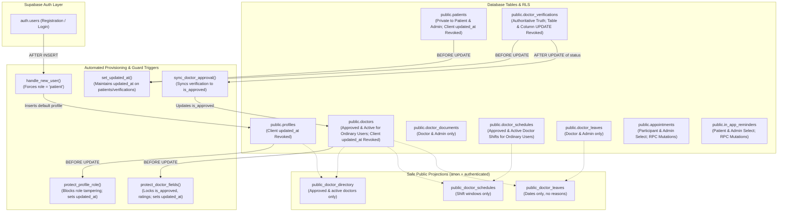
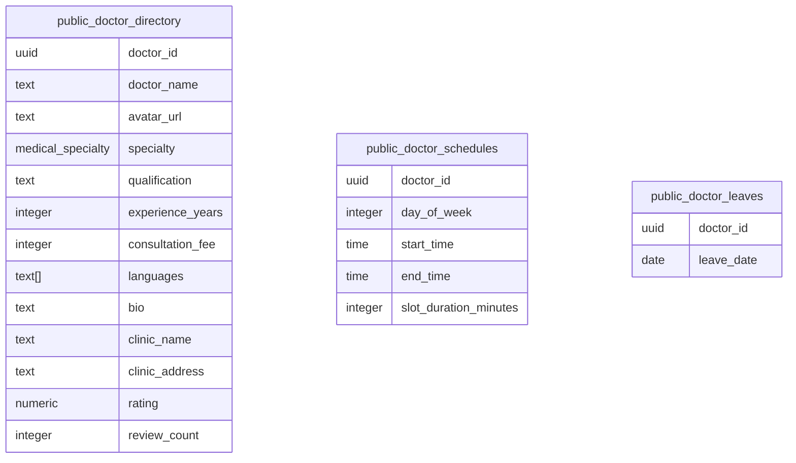

# VoiceCare Phase 2 — Part 2: Authentication and Roles Design (Final Revision)

**Scope:** Authentication, User Profiles, Role-Based Access Control (RBAC), Row Level Security (RLS), Public Views, Security Functions, Server-Controlled Auditing, and Deterministic Privilege Resets.  
**Prerequisites:** Depends strictly on Part 1 (`voicecare_part1_database.sql`). Part 1 schema must be created before applying Part 2.  
**Explicitly Excluded:** Storage bucket creation and Storage RLS policies (Part 3), Onboarding and Booking RPCs (Part 4), Admin verification decision UI/endpoints (Part 5), Frontend code modifications.  
**Intended Owner:** `postgres` (database superuser).  
**Status:** Design blueprint — review document only (not executed on a live database).

---

## 1. Executive Summary & Review Revisions

Following a focused security review, Part 2 incorporates the following final technical corrections:

1. **Deterministic Privilege Reset (Table-Level & Column-Level REVOKEs):**  
   - In PostgreSQL, executing `REVOKE ALL ON table FROM role` revokes table-level privileges but **does not necessarily clear previously granted column-level privileges**. Stale column-level grants from prior migrations or test runs could therefore linger.
   - Part 2 explicitly executes both table-level and column-level `REVOKE ALL (<all_columns>) ON public.<table_name> FROM PUBLIC, anon, authenticated` across all nine Part 1 tables before applying targeted grants.
   - Specifically guarantees that authenticated clients have **zero direct UPDATE privileges** on `public.doctor_verifications`, including `status`, `registration_number`, `issuing_authority`, `admin_notes`, and audit columns.
2. **Doctor Schedule Visibility Alignment:**  
   - Previously, `doctor_schedules` allowed authenticated users to read any shift where `is_active = true`, which accidentally exposed schedule shifts for unapproved or inactive doctors.
   - The revised policy restricts general authenticated access to active schedules of doctors who are **both approved and active** (`d.is_approved = true AND d.is_active = true`).
   - Doctors retain full access to their own shifts (active or inactive, approved or pending); administrators retain full access to all shifts.
   - The subquery targets `public.doctors` directly; because `doctors` does not query `doctor_schedules`, no recursive RLS cycle is created.
3. **Doctor Profile Visibility Alignment:**  
   - Previously, the `doctors` SELECT policy permitted ordinary authenticated users to view profiles with `is_approved = true`, even if `is_active = false` (e.g. paused practice or sabbatical).
   - The revised policy requires `is_approved = true AND is_active = true` for ordinary users, matching the public directory view. Doctors can always view their own profile; administrators can view all profiles.
4. **Doctor Verification Status Updates (Part 5 Server-Side Boundary):**  
   - `doctor_verifications.status` is the single source of truth for doctor verification.
   - Direct `UPDATE` and `DELETE` on `public.doctor_verifications` remain **strictly revoked** from authenticated clients at both table and column levels.
   - Part 5 must perform verification-status changes through a trusted server-side `SECURITY DEFINER` function (e.g. `public.review_doctor_application()`) that validates the caller's administrator role (`public.is_admin()`).
   - The `sync_doctor_approval()` trigger remains active to synchronize `doctors.is_approved = (NEW.status = 'approved')`.
5. **Resolved Doctor-Document Administrator Policy Ambiguity:**  
   - Doctors can manage (`SELECT`, `INSERT`, `DELETE`) document metadata only for themselves (`doctor_id = auth.uid() AND public.is_doctor()`).
   - Verified administrators (`public.is_admin()`) can inspect, upload (`INSERT`), and delete document metadata for any doctor (e.g. offline credential ingestion).
   - Patients are strictly barred from all document operations.
6. **Server-Controlled `updated_at` Timestamps:**  
   - Client `UPDATE` permissions on `updated_at` are completely revoked across `profiles`, `patients`, and `doctors` at both table and column levels.
   - Automated server-side triggers maintain timestamps: `protect_profile_role()` on `profiles`, `protect_doctor_fields()` on `doctors`, and `set_updated_at()` on `patients` and `doctor_verifications`.
7. **Syntax & Ownership Hardening:**  
   - Bare keywords (`COALESCE`, `NULLIF`, `CURRENT_DATE`) without invalid schema prefixes.
   - Preflight superuser assertion (`current_user = 'postgres'`) and explicit `ALTER ... OWNER TO postgres;` for all functions and views.
   - `SET search_path = pg_catalog` on all `SECURITY DEFINER` functions with fully schema-qualified application objects.



---

## 2. Supabase Auth Integration & Role Security

### 2.1 The Three Application Roles
VoiceCare recognizes three distinct personas represented by the `public.user_role` ENUM:
1. **`patient`:** Default role for all public self-registrations. Can book appointments, manage their demographic profile, view own appointments, and receive in-app reminders.
2. **`doctor`:** Medical practitioner. Can configure availability schedules, declare leaves, view assigned patient appointments, and update consultation clinical notes.
3. **`admin`:** System administrator. Can review doctor credentials, approve/reject doctor applications, inspect verification documents, and audit platform activity.

### 2.2 Untrusted Signup Metadata & Safe Default Assignment
* **Vulnerability Identified:** In client-side Supabase Auth, `supabase.auth.signUp({ options: { data: { role: 'admin' } } })` allows arbitrary JSON in `raw_user_meta_data`. If the trigger reads `NEW.raw_user_meta_data->>'role'`, any user could promote themselves to an administrator or verified doctor.
* **Security Enforcement:**
  - `handle_new_user()` **strictly ignores** any `role` key in `raw_user_meta_data`.
  - Every user registering through public signup is unconditionally assigned `role = 'patient'::public.user_role`.
  - Initial administrator accounts can **never** be created through public registration.
  - Doctor roles cannot be acquired through self-signup; onboarding requires the trusted Part 4 RPC `submit_doctor_application()`.

### 2.3 User Role Immutability
* **Two-Layer Enforcement:**
  1. **SQL Column Privilege Layer:** The `UPDATE` privilege granted to `authenticated` users on `public.profiles` explicitly grants only `(full_name, phone, avatar_url)`. All other columns (`role`, `id`, `created_at`, `updated_at`) are explicitly revoked at both table and column levels.
  2. **Trigger Guard Layer (`protect_profile_role`):** A `BEFORE UPDATE` trigger on `public.profiles` verifies whether `NEW.role IS DISTINCT FROM OLD.role`. If any user attempts to alter `role`:
     - Authenticated clients (`auth.uid() IS NOT NULL`) cannot modify their own role under any circumstances.
     - Administrators cannot demote or promote their own account (prevents accidental lockout).

### 2.4 Initial Admin Provisioning Protocol
Because public registration cannot produce an admin, initial administrator accounts are provisioned via a secure, dashboard-only procedure:
1. The prospective administrator registers through Supabase Auth, receiving an ordinary user UUID and default `patient` profile.
2. A database superuser (with direct access to the Supabase SQL Editor or psql connection) executes the restricted bootstrap function:
   ```sql
   SELECT public.bootstrap_admin_role('00000000-0000-0000-0000-000000000000'::uuid);
   ```
3. **Security Safeguards on `bootstrap_admin_role`:**
   - Explicitly `REVOKE ALL` from `PUBLIC`, `anon`, and `authenticated`.
   - Function checks `session_user = 'postgres'` and `auth.uid() IS NULL` (ensuring it cannot be called over PostgREST HTTP connections even if grants were misconfigured).

---

## 3. Helper Functions & Authorization Primitives

To eliminate recursive RLS lookups and provide performant, centralized authorization, Part 2 introduces four helper functions:

| Function | Return Type | Volatility & Security | Search Path | Purpose |
| :--- | :--- | :--- | :--- | :--- |
| `public.auth_user_role()` | `public.user_role` | `STABLE SECURITY DEFINER` | `pg_catalog` | Returns the role of `auth.uid()` from `public.profiles`. |
| `public.is_admin()` | `BOOLEAN` | `STABLE SECURITY DEFINER` | `pg_catalog` | Returns `true` if `auth.uid()` has role `'admin'`, `false` otherwise. |
| `public.is_doctor()` | `BOOLEAN` | `STABLE SECURITY DEFINER` | `pg_catalog` | Returns `true` if `auth.uid()` has role `'doctor'`, `false` otherwise. |
| `public.is_patient()` | `BOOLEAN` | `STABLE SECURITY DEFINER` | `pg_catalog` | Returns `true` if `auth.uid()` has role `'patient'`, `false` otherwise. |

### 3.1 Hardened `search_path` and Recursive RLS Mitigation
- All helper functions run as `SECURITY DEFINER` owned by `postgres` with `SET search_path = pg_catalog`.
- All referenced tables and types are schema-qualified (`public.profiles`, `public.user_role`, etc.).
- When `postgres` queries `public.profiles` inside these helper functions, PostgreSQL evaluates the query under the owner's privileges (which bypasses RLS on `public.profiles`), breaking circular evaluation loops.
- On `public.profiles` itself, the base SELECT policy for ordinary users evaluates `id = auth.uid()` directly.

---

## 4. Public Projection Views (Safe Anonymous Access)

Direct access to base tables (`doctors`, `doctor_schedules`, `doctor_leaves`) is revoked from `anon`. Public browsing is mediated through security-barrier views:



1. **`public_doctor_directory`:**
   - Filters strictly to `d.is_approved = true AND d.is_active = true`.
   - Joins `public.doctors` with `public.profiles` to present `doctor_name` (full_name) and `avatar_url`.
   - **Excludes:** `phone`, email, `registration_number`, internal notes, and `created_at`.
2. **`public_doctor_schedules`:**
   - Exposes shift availability windows for approved and active doctors.
   - Used by frontend calendar widgets to render available booking slots.
   - **Excludes:** Internal shift IDs and inactive schedules.
3. **`public_doctor_leaves`:**
   - Exposes unavailable dates (`leave_date >= CURRENT_DATE`) for approved and active doctors.
   - **Critical Security Boundary:** The private `reason` column is **strictly omitted**. Patients and unauthenticated visitors can see *that* a doctor is away, but *never why*.

---

## 5. Row Level Security (RLS) Policy Matrix

RLS is enabled on all nine tables. RLS policies control row visibility, while SQL grants control table/column command access.

| Table | Operation | Target Role | Policy Condition (USING / WITH CHECK) | Description / Boundary |
| :--- | :---: | :---: | :--- | :--- |
| `profiles` | SELECT | `authenticated` | `id = auth.uid() OR public.is_admin()` | Self or admin inspection |
| `profiles` | UPDATE | `authenticated` | `id = auth.uid()` | Update personal details only (role locked) |
| `patients` | SELECT | `authenticated` | `(id = auth.uid() AND public.is_patient()) OR public.is_admin()` | Private to owning patient & admin. Doctors strictly blocked. |
| `patients` | INSERT | `authenticated` | `id = auth.uid() AND public.is_patient()` | Only patients onboard patient demographic profile |
| `patients` | UPDATE | `authenticated` | `(id = auth.uid() AND public.is_patient()) OR public.is_admin()` | Edit own clinical profile |
| `doctors` | SELECT | `authenticated` | `(is_approved = true AND is_active = true) OR (id = auth.uid() AND public.is_doctor()) OR public.is_admin()` | Approved & active directory view; doctor sees self; admin sees all |
| `doctors` | INSERT | `authenticated` | `public.is_admin()` | Direct client INSERT revoked; handled via Part 4 RPC |
| `doctors` | UPDATE | `authenticated` | `(id = auth.uid() AND public.is_doctor()) OR public.is_admin()` | Doctor edits practice profile (ratings/approval locked) |
| `doctor_verifications` | SELECT | `authenticated` | `(doctor_id = auth.uid() AND public.is_doctor()) OR public.is_admin()` | Doctor tracks status; admin reviews queue |
| `doctor_verifications` | INSERT | `authenticated` | `public.is_admin()` | Direct client INSERT revoked; handled via Part 4 RPC |
| `doctor_verifications` | UPDATE | `authenticated` | `public.is_admin()` | Only admins review & decide on verifications (Part 5 server-side RPC) |
| `doctor_documents` | SELECT | `authenticated` | `(doctor_id = auth.uid() AND public.is_doctor()) OR public.is_admin()` | Credentials private to owning doctor and admin |
| `doctor_documents` | INSERT | `authenticated` | `(doctor_id = auth.uid() AND public.is_doctor()) OR public.is_admin()` | Owning doctor or admin uploads document metadata |
| `doctor_documents` | DELETE | `authenticated` | `(doctor_id = auth.uid() AND public.is_doctor()) OR public.is_admin()` | Owning doctor or admin removes document metadata |
| `doctor_schedules` | SELECT | `authenticated` | `(doctor_id = auth.uid() AND public.is_doctor()) OR public.is_admin() OR (is_active = true AND EXISTS (SELECT 1 FROM public.doctors d WHERE d.id = doctor_schedules.doctor_id AND d.is_approved = true AND d.is_active = true))` | Active shifts of approved & active doctors queryable; doctor sees own shifts; admin sees all |
| `doctor_schedules` | ALL | `authenticated` | `(doctor_id = auth.uid() AND public.is_doctor()) OR public.is_admin()` | Only doctors/admins configure recurring shifts |
| `doctor_leaves` | SELECT | `authenticated` | `(doctor_id = auth.uid() AND public.is_doctor()) OR public.is_admin()` | Full leaves (with reasons) private to doctor/admin |
| `doctor_leaves` | ALL | `authenticated` | `(doctor_id = auth.uid() AND public.is_doctor()) OR public.is_admin()` | Only doctors/admins log calendar leave dates |
| `appointments` | SELECT | `authenticated` | `patient_id = auth.uid() OR doctor_id = auth.uid() OR public.is_admin()` | Consultation participants & admin only |
| `in_app_reminders` | SELECT | `authenticated` | `patient_id = auth.uid() OR public.is_admin()` | Notification inbox private to patient |

> [!IMPORTANT]
> **No Direct Client Mutations on Appointments, Reminders, or Verifications:**  
> - Direct `INSERT`, `UPDATE`, and `DELETE` on `public.appointments` and `public.in_app_reminders` are **completely revoked** from `authenticated`. All consultation bookings, reschedules, cancellations, doctor responses, and reminder dismissals must execute through atomic `SECURITY DEFINER` RPCs in Part 4.  
> - Direct `UPDATE` and `DELETE` on `public.doctor_verifications` are **completely revoked** from client roles at both table and column levels. Part 5 must perform verification-status changes through a trusted server-side `SECURITY DEFINER` function (e.g. `public.review_doctor_application()`) that validates the caller's administrator role and invokes the approval synchronization trigger.

---

## 6. PostgreSQL Privileges & Deterministic Grants Matrix

To ensure deterministic privileges regardless of prior environment state, all tables have privileges revoked at both table and column levels before minimum required grants are applied. All client `UPDATE` permissions on `updated_at` and `doctor_verifications` are completely revoked:

| Relation / Object | `anon` Privileges | `authenticated` Privileges | Restricted / Excluded Columns (Revoked at Column Level) | Server-Controlled `updated_at` Trigger |
| :--- | :--- | :--- | :--- | :---: |
| `public.profiles` | *None* | `SELECT`, `UPDATE (full_name, phone, avatar_url)` | `role`, `id`, `created_at`, `updated_at` explicitly revoked at column level | `protect_profile_role()` |
| `public.patients` | *None* | `SELECT`, `INSERT`, `UPDATE (age_value, age_unit, date_of_birth, gender, blood_group, emergency_phone, medical_notes)` | `id`, `created_at`, `updated_at` explicitly revoked at column level; RLS blocks non-patients | `set_updated_at()` |
| `public.doctors` | *None* | `SELECT`, `UPDATE (qualification, experience_years, consultation_fee, languages, bio, clinic_name, clinic_address, is_active)` | `INSERT` revoked (RPC-only); `is_approved`, `rating`, `review_count`, `id`, `updated_at` explicitly revoked at column level | `protect_doctor_fields()` |
| `public.doctor_verifications` | *None* | `SELECT` | `INSERT`, `UPDATE`, `DELETE` revoked at table AND column levels (status changes via Part 5 RPC) | `set_updated_at()` & `sync_doctor_approval()` |
| `public.doctor_documents` | *None* | `SELECT`, `INSERT`, `DELETE` | `UPDATE` revoked (immutable metadata); RLS blocks non-doctors | N/A (immutable) |
| `public.doctor_schedules` | *None* | `SELECT`, `INSERT`, `UPDATE`, `DELETE` | RLS blocks non-doctors | N/A |
| `public.doctor_leaves` | *None* | `SELECT`, `INSERT`, `UPDATE`, `DELETE` | RLS blocks non-doctors | N/A |
| `public.appointments` | *None* | `SELECT` | `INSERT`, `UPDATE`, `DELETE` revoked at table and column levels (RPC-only) | Maintained in Part 4 RPCs |
| `public.in_app_reminders` | *None* | `SELECT` | `INSERT`, `UPDATE`, `DELETE` revoked at table and column levels (RPC-only) | N/A |
| `public.public_doctor_directory` | `SELECT` | `SELECT` | Public view | N/A |
| `public.public_doctor_schedules` | `SELECT` | `SELECT` | Public view | N/A |
| `public.public_doctor_leaves` | `SELECT` | `SELECT` | Public view | N/A |
| Helper Functions (`is_admin`, etc.) | *None* | `EXECUTE` | Private utility functions | N/A |
| `bootstrap_admin_role` | *None* | *None* | Restricted to `postgres` superuser only | N/A |

---

## 7. Execution Dependency & Sequencing Contract

1. **Prerequisite:** Part 1 (`voicecare_part1_database.sql`) must be executed first to create extensions, ENUM types, tables, constraints, and indexes.
2. **Part 2 Execution Sequence:**
   - Preflight assertion verifying `current_user = 'postgres'`.
   - Section 1: Security Helper Functions (`auth_user_role`, `is_admin`, `is_doctor`, `is_patient`) + `ALTER OWNER TO postgres`.
   - Section 2: Admin Bootstrap Utility (`bootstrap_admin_role`) + `ALTER OWNER TO postgres`.
   - Section 3: Trigger Functions & Triggers (`handle_new_user`, `protect_profile_role`, `protect_doctor_fields`, `sync_doctor_approval`, `set_updated_at`) + `ALTER OWNER TO postgres`.
   - Section 4: Public Directory Views (`public_doctor_directory`, `public_doctor_schedules`, `public_doctor_leaves`) + `ALTER OWNER TO postgres`.
   - Section 5: Surgical policy cleanup and RLS policy creation across all 9 tables.
   - Section 6: Deterministic `REVOKE ALL` (table-level AND column-level) followed by least-privilege `GRANT` statements.
3. **Subsequent Handoff:**
   - Part 3 will establish Supabase Storage buckets and `storage.objects` RLS policies.
   - Part 4 will introduce transactional onboarding (`complete_patient_onboarding`, `submit_doctor_application`) and appointment lifecycle RPCs.
   - Part 5 will establish the administrator review UI and trusted server-side verification decision RPC.
