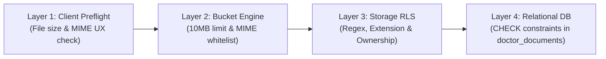
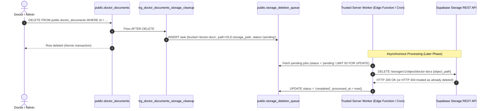

# VoiceCare Phase 2 — Part 3: Supabase Storage and Doctor Verification Documents Design (Final Revision)

**Scope:** Supabase Storage Architecture, Private Credential Storage, Multi-Factor Ownership Enforcement, Defense-in-Depth Path and Metadata Validation, Row Level Security (RLS) on Storage Objects, Permissive Policy Interaction Analysis, Safe Client Access Patterns, and Asynchronous Deletion Queue Architecture.  
**Prerequisites:** Depends strictly on Part 1 (`voicecare_part1_database.sql`) and Part 2 (`voicecare_part2_auth.sql`).  
**Explicitly Excluded:** Onboarding and Booking RPCs (Part 4), Admin verification decision UI / RPC endpoints (Part 5), Frontend UI implementations, Background Edge Function worker code (operational deployment phase).  
**Intended Owner:** `postgres` (database superuser).  
**Status:** Design blueprint — review document only (not executed on a live database).

---

## 1. Executive Summary & Review Revisions

Doctor verification documents are sensitive medical credentials (such as State Medical Council registration certificates, National Medical Commission qualifications, university degree certificates, and government identity proofs). Following a comprehensive security review, Part 3 establishes a zero-trust storage layer with the following technical enhancements:

1. **Safe Asynchronous Storage Cleanup Architecture (No Direct `storage.objects` SQL Deletions):**  
   - **Vulnerability Identified:** In Supabase Storage, `storage.objects` is an internal PostgreSQL catalog table managed by the Supabase Storage Go service. The actual binary blobs reside in cloud object storage (Amazon S3, Google Cloud Storage, or MinIO). Directly executing `DELETE FROM storage.objects` in a database trigger removes the database row but **does not delete the physical file on S3**, creating orphaned blobs and desynchronizing storage state.
   - **Engineered Solution:** Database triggers **never** directly delete or modify `storage.objects`. Instead, deleting a metadata row from `public.doctor_documents` safely enqueues a deletion task into `public.storage_deletion_queue`. A trusted, idempotent server-side worker (e.g. Supabase Edge Function using the official Supabase Storage API: `supabase.storage.from('doctor-docs').remove([path])`) processes this queue with automated retries, error handling, and 404/missing object idempotency.
2. **Strict Storage Path Structure:**  
   - Enforces the exact structure: `doctor_uuid/filename.ext` with **exactly one slash**.
   - Rejects empty segments, leading/trailing whitespace, trailing slashes, nested subdirectories, repeated slashes (`//`), backslashes (`\`), directory traversal sequences (`..`), and unsafe filenames.
   - Enforces a standard 36-character UUID format for `doctor_uuid` and validates allowed file extensions against a strict whitelist.
3. **Safe, Fail-Closed Metadata Validation (Cast Protection):**  
   - `metadata->>'size'` is validated using regular expressions (`^[0-9]{1,8}$`) **before** casting to `bigint`. This eliminates unhandled runtime database exceptions when clients submit malformed or non-numeric metadata.
   - Validates that size is strictly positive ($> 0$) and does not exceed 10 MB (10,485,760 bytes).
   - Validates MIME types against the approved bucket allowlist (`application/pdf`, `image/png`, `image/jpeg`, `image/webp`).
   - Fails closed with `EXCEPTION WHEN OTHERS THEN RETURN false;` on any unexpected JSON anomaly.
4. **PostgreSQL RLS Permissive Policy Interaction & Surgical Cleanup:**  
   - Acknowledges that in PostgreSQL, multiple `PERMISSIVE` policies combine using logical `OR`. If an unscoped policy exists on `storage.objects`, it can inadvertently expose objects across buckets.
   - Part 3 surgically drops only the policies created for `doctor-docs` by name, leaving unrelated application bucket policies intact.
   - Every single policy on `storage.objects` strictly begins with `bucket_id = 'doctor-docs' AND ...`.
   - Provides an administrative audit query using `pg_policies` to verify that no wildcard policies exist on `storage.objects`.
5. **Multi-Factor Ownership Verification:**  
   - Validates ownership not by user-supplied paths alone, but through a multi-factor database correlation:
     1. Authenticated session token (`auth.uid() IS NOT NULL`).
     2. Profile role validation (`public.is_doctor()` checks `public.profiles.role = 'doctor'`).
     3. Relational table existence (`EXISTS (SELECT 1 FROM public.doctors WHERE id = auth.uid())`).
     4. Path prefix correlation (`split_part(name, '/', 1) = auth.uid()::text`).
   - Patients evaluating these policies evaluate to `false` unconditionally across all operations.
6. **Zero Service-Role Key Exposure in Frontend:**  
   - All client interactions (doctor uploads, doctor document views, admin reviews) occur via authenticated client sessions utilizing standard Supabase client SDK methods (`upload`, `createSignedUrl`, `download`).
   - The `service_role` key is strictly forbidden from client bundles.
7. **Accurate Regulatory Alignment:**  
   - Private bucket storage and least-privilege RLS are presented accurately as **necessary technical controls** toward compliance with Indian digital health data governance guidelines (NDHM/ABDM) and DISHA principles. They do not claim that bucket settings alone guarantee full legal compliance, which requires end-to-end operational, legal, and consent management frameworks.

```mermaid
flowchart TD
    subgraph ClientLayer["Client Layer (Web / Mobile)"]
        DOC["Doctor Client<br/>(JWT: role='doctor')"]
        ADM["Admin Client<br/>(JWT: role='admin')"]
        PAT["Patient Client<br/>(JWT: role='patient')"]
        PUB["Public / Anonymous<br/>(No JWT or anon)"]
    end

    subgraph StorageGate["Supabase Storage Engine (REST API)"]
        BUCKET["storage.buckets<br/>('doctor-docs', public=false, limit=10MB)"]
        OBJ["storage.objects (RLS Enabled)"]
    end

    subgraph SecurityChecks["Part 3 Security & Ownership Gate"]
        CHK_ROLE["Role Verification<br/>(is_doctor() / is_admin())"]
        CHK_REL["Relational Doctor Check<br/>(EXISTS in public.doctors)"]
        CHK_PATH["Path & Regex Check<br/>(Exactly 1 slash, UUID, safe file)"]
        CHK_MIME["Safe Metadata Check<br/>(Regex pre-cast, <=10MB, MIME)"]
    end

    subgraph RelationalDB["PostgreSQL Database Foundation"]
        META["public.doctor_documents<br/>(Part 1 Foundation)"]
        QUEUE["public.storage_deletion_queue<br/>(Asynchronous Cleanup Tasks)"]
    end

    subgraph ServerWorker["Trusted Server-Side Component (Later Phase)"]
        WORKER["Edge Function / Cron Worker<br/>(Calls Storage API: remove())"]
    end

    DOC -->|Upload / View / Delete own| OBJ
    ADM -->|Review / Ingest / Manage all| OBJ
    PAT -->|BLOCKED (403 Forbidden)| OBJ
    PUB -->|BLOCKED (404/403 Forbidden)| BUCKET

    OBJ --> CHK_ROLE
    CHK_ROLE --> CHK_REL
    CHK_REL --> CHK_PATH
    CHK_PATH --> CHK_MIME

    META -->|AFTER DELETE trigger| QUEUE
    QUEUE -.->|Read pending jobs| WORKER
    WORKER -.->|Calls Storage REST API| StorageGate
```

---

## 2. Storage Bucket Architecture & Hierarchy

### 2.1 Bucket Specification

The storage bucket is registered in `storage.buckets` with configuration parameters enforcing strict privacy and boundary limits:

| Parameter | Value | Enforcement Layer | Description / Purpose |
| :--- | :--- | :--- | :--- |
| **`id`** | `'doctor-docs'` | Unique identifier | Target bucket identifier across all storage APIs. |
| **`name`** | `'doctor-docs'` | Display name | Matches bucket ID for consistency. |
| **`public`** | `false` | Supabase Storage Engine | **Private bucket.** Direct public CDN URLs are disabled. |
| **`file_size_limit`** | `10485760` (10 MB) | Bucket Configuration & RLS | Maximum payload size per uploaded credential file. |
| **`allowed_mime_types`** | `['application/pdf', 'image/png', 'image/jpeg', 'image/webp']` | Bucket Configuration & RLS | Restricts upload payloads to official document and certificate formats. |

### 2.2 Strict Object Naming Convention & Directory Hierarchy

All objects stored inside the `doctor-docs` bucket follow a deterministic, single-level hierarchy:

```text
doctor-docs/
  └── <doctor_uuid>/
        ├── medical_license_1732200000_a1b2c3.pdf
        ├── degree_certificate_1732200000_d4e5f6.pdf
        ├── identity_proof_1732200000_7g8h9i.png
        └── other_1732200000_j1k2l3.jpg
```

#### Strict Path Hierarchy Rules:
1. **Exactly One Slash:** The object path must contain exactly one `/` delimiter separating the folder from the filename: `length(p_name) - length(replace(p_name, '/', '')) = 1`.
2. **Top-Level Directory:** Must be the doctor's exact 36-character UUID (`^[0-9a-fA-F]{8}-[0-9a-fA-F]{4}-[0-9a-fA-F]{4}-[0-9a-fA-F]{4}-[0-9a-fA-F]{12}$`).
3. **No Nested Subdirectories:** Nested folders (e.g. `<doctor_uuid>/subfolder/file.pdf`) are strictly rejected.
4. **No Whitespace or Traversal:** Leading or trailing whitespace in either segment, double slashes (`//`), backslashes (`\`), or traversal sequences (`..`) are strictly rejected.
5. **Safe Filename Format:** Filenames must be between 5 and 255 characters, must start with an alphanumeric character, underscore, or hyphen (cannot start with a dot/hidden file), and must end with an alphanumeric character (`^[a-zA-Z0-9_\-][a-zA-Z0-9_\-\.]{0,253}[a-zA-Z0-9]$`).
6. **Allowed Extensions:** Extracted from characters following the last period and matched against the lowercase whitelist: `pdf`, `png`, `jpg`, `jpeg`, `webp`.

### 2.3 Strict Alignment with Part 1 Database Schema

In Part 1 (`public.doctor_documents`), the table definition includes an explicit CHECK constraint on `storage_path`:

```sql
CONSTRAINT chk_doctor_documents_storage_path
    CHECK (
        storage_path LIKE (doctor_id::text || '/%')
        AND storage_path NOT LIKE '%/'
        AND length(trim(substring(storage_path from (length(doctor_id::text) + 2)))) > 0
    )
```

- In `public.doctor_documents`, `storage_path` stores the relative object path within the bucket: `{doctor_id}/{filename}` (the bucket name `'doctor-docs'` is NOT prefixed).
- In `storage.objects`, the column `name` stores this exact identical string: `{doctor_id}/{filename}`.
- Therefore:
  $$\text{public.doctor\_documents.storage\_path} \equiv \text{storage.objects.name}$$
  This 1-to-1 match allows direct relational joins, unambiguous foreign reference verification, and seamless asynchronous deletion enqueuing.

---

## 3. Role-Based Access Control & RLS Matrix

Access to objects in `storage.objects` for `bucket_id = 'doctor-docs'` is governed exclusively by PostgreSQL Row Level Security. All requests evaluate the caller's JWT claims.

### 3.1 Permissions Matrix

| Persona | Role (`public.profiles.role`) | SELECT (Download / View) | INSERT (Upload) | UPDATE (Upsert / Overwrite) | DELETE (Remove) |
| :--- | :--- | :--- | :--- | :--- | :--- |
| **Anonymous (`anon`)** | None | ❌ **DENIED** (Revoked) | ❌ **DENIED** (Revoked) | ❌ **DENIED** (Revoked) | ❌ **DENIED** (Revoked) |
| **Patient (`authenticated`)** | `'patient'` | ❌ **DENIED** (RLS false) | ❌ **DENIED** (RLS false) | ❌ **DENIED** (RLS false) | ❌ **DENIED** (RLS false) |
| **Doctor (`authenticated`)** | `'doctor'` | ✅ **ALLOWED** (Own files only) | ✅ **ALLOWED** (Own folder only) | ✅ **ALLOWED** (Own files only) | ✅ **ALLOWED** (Own files only) |
| **Admin (`authenticated`)** | `'admin'` | ✅ **ALLOWED** (All doctor files) | ✅ **ALLOWED** (All doctor folders) | ✅ **ALLOWED** (All doctor files) | ✅ **ALLOWED** (All doctor files) |

### 3.2 Row Level Security Policies Detailed Breakdown

#### 1. SELECT Policy: `"doctor_docs: select own or admin"`
```sql
CREATE POLICY "doctor_docs: select own or admin"
    ON storage.objects FOR SELECT TO authenticated
    USING (
        bucket_id = 'doctor-docs'
        AND (
            public.is_doctor_document_owner(name)
            OR public.is_admin()
        )
    );
```
- **Doctor Check:** `public.is_doctor_document_owner(name)` guarantees that the doctor is authenticated, possesses role `'doctor'`, exists in `public.doctors`, passes path validation, and `split_part(name, '/', 1) = auth.uid()::text`.
- **Admin Check:** `public.is_admin()` allows administrators to review any document in the bucket.
- **Patient Exclusion:** Evaluates to `false` unconditionally.

#### 2. INSERT Policy: `"doctor_docs: insert own or admin"`
```sql
CREATE POLICY "doctor_docs: insert own or admin"
    ON storage.objects FOR INSERT TO authenticated
    WITH CHECK (
        bucket_id = 'doctor-docs'
        AND public.validate_doctor_document_path(name)
        AND public.validate_doctor_document_metadata(metadata)
        AND (
            public.is_doctor_document_owner(name)
            OR public.is_admin()
        )
    );
```
- Requires path validation (`public.validate_doctor_document_path(name)`).
- Requires metadata validation (`public.validate_doctor_document_metadata(metadata)`).
- Doctor must be the owner of the target folder prefix.
- Admins can upload on behalf of doctors (offline ingestion), subject to path and metadata checks.

#### 3. UPDATE Policy: `"doctor_docs: update own or admin"`
```sql
CREATE POLICY "doctor_docs: update own or admin"
    ON storage.objects FOR UPDATE TO authenticated
    USING (
        bucket_id = 'doctor-docs'
        AND (
            public.is_doctor_document_owner(name)
            OR public.is_admin()
        )
    )
    WITH CHECK (
        bucket_id = 'doctor-docs'
        AND public.validate_doctor_document_path(name)
        AND public.validate_doctor_document_metadata(metadata)
        AND (
            public.is_doctor_document_owner(name)
            OR public.is_admin()
        )
    );
```
- Applies when a client performs an `upsert` upload.
- Enforces both `USING` (permission to access existing object) and `WITH CHECK` (permission to write new payload attributes, maintaining path, size, and MIME validation).

#### 4. DELETE Policy: `"doctor_docs: delete own or admin"`
```sql
CREATE POLICY "doctor_docs: delete own or admin"
    ON storage.objects FOR DELETE TO authenticated
    USING (
        bucket_id = 'doctor-docs'
        AND (
            public.is_doctor_document_owner(name)
            OR public.is_admin()
        )
    );
```
- Allows doctors to delete their own uploaded documents.
- Allows administrators to remove non-compliant files.

### 3.3 Permissive Policy OR Combination Mechanics & Preflight Conflict Detection

#### 1. The PostgreSQL Permissive Evaluation Model
In PostgreSQL Row Level Security, policies can be created as `PERMISSIVE` (the default) or `RESTRICTIVE`.
When multiple permissive policies exist on a table for a given role and command (e.g. `SELECT` on `storage.objects` for `authenticated`), PostgreSQL combines them with logical `OR`:
$$\text{Access Granted} \iff \text{Policy}_1 \lor \text{Policy}_2 \lor \dots \lor \text{Policy}_n$$

#### 2. The Cross-Bucket Exposure Hazard
If another extension, template, or manual migration in the Supabase project creates a general policy on `storage.objects` without an explicit `bucket_id` predicate (for example: `CREATE POLICY "public read" ON storage.objects FOR SELECT TO authenticated USING (true);`), that permissive policy evaluates to `true` across **all** buckets.
Because $\text{false} \lor \text{true} \implies \textbf{true}$, an unscoped foreign policy completely bypasses VoiceCare's `"doctor_docs: select own or admin"` policy, exposing private doctor credentials to patients or anonymous visitors.

#### 3. Conservative Fail-Closed Migration Preflight Gate (Assertion 6)
To eliminate the risk of silent cross-bucket data leakage while never altering unrelated or existing application policies:
- `voicecare_phase2_part3_storage.sql` enforces an automated, conservative fail-closed preflight assertion (Assertion 6) that queries `pg_catalog.pg_policies` before applying any changes.
- **Why heuristic expression parsing is avoided:** String inspection or pattern matching in PL/pgSQL cannot reliably prove that a foreign policy safely excludes `doctor-docs` under complex boolean logic (e.g. nested disjunctions, function calls, subqueries, or partial bucket checks).
- **Conservative Fail-Closed Standard:**
  1. The preflight detects **every** permissive policy (`permissive = 'PERMISSIVE'`) on `storage.objects` where applicable roles include `authenticated`, `anon`, `public`, or the empty role array `{}` (representing `PUBLIC`).
  2. It excludes **only** the 8 explicitly identified VoiceCare-managed policies:
     - Active policies: `'doctor_docs: select own or admin'`, `'doctor_docs: insert own or admin'`, `'doctor_docs: update own or admin'`, `'doctor_docs: delete own or admin'`.
     - Legacy naming variants: `'doctor-docs: doctor upload own'`, `'doctor-docs: doctor read own'`, `'doctor-docs: doctor delete own'`, `'doctor-docs: admin read all'`.
  3. If **any** foreign applicable permissive policy exists on `storage.objects` for `SELECT`, `INSERT`, `UPDATE`, `DELETE`, or `ALL`, the migration **halts immediately with `RAISE EXCEPTION`**.
  4. The exception formats and logs each offending policy's:
     - Policy name (`policyname`)
     - Target command (`cmd`: `SELECT`, `INSERT`, `UPDATE`, `DELETE`, or `ALL`)
     - Applicable roles (`roles`)
     - `USING` expression (`qual`)
     - `WITH CHECK` expression (`with_check`)
  5. The migration **never** automatically drops, modifies, or converts foreign policies.

#### 4. Administrator Remediation Workflow
When Preflight Assertion 6 halts execution due to foreign permissive policies on `storage.objects`, a database administrator must perform manual review and remediation:
1. **Analyze Detected Policies:** Inspect the reported policy definitions in the preflight error output.
2. **Safely Scope Bucket-Specific Policies:**
   If a policy was intended only for another bucket (e.g. `avatars` or `public-assets`), explicitly scope its `USING` and `WITH CHECK` clauses so it does not evaluate across the entire table without bucket constraints.
3. **Convert Global Cross-Cutting Policies to RESTRICTIVE:**
   If a policy enforces a project-wide rule (e.g. tenant isolation or active account checks) that applies across all buckets, re-create it as a `RESTRICTIVE` policy (`CREATE POLICY ... AS RESTRICTIVE ...`). In PostgreSQL, restrictive policies combine with logical `AND`, ensuring they narrow permissions rather than granting broad access via `OR`.
4. **Re-Run Migration:** Re-execute `voicecare_phase2_part3_storage.sql` once all foreign permissive policies on `storage.objects` have been manually reviewed and resolved.

#### 5. Migration Security Guarantee
The Part 3 migration guarantees absolute privacy and multi-factor isolation for `doctor-docs` against patients, anonymous users, and cross-doctor tampering, **strictly guaranteed by the fail-closed assertion that no unreviewed foreign permissive policies exist on `storage.objects`**.

---

## 4. Multi-Factor Ownership & Identity Verification

### 4.1 Vulnerability of Path-Only Checks
A common flaw in naive storage policies is checking only that the path prefix matches `auth.uid()::text`:
```sql
-- INSECURE NAIVE PATTERN:
(storage.foldername(name))[1] = auth.uid()::text
```
**Why this fails:**
A malicious user registered as a `patient` has a valid `auth.uid()`. Under the naive policy, the patient could create a folder matching their own UUID inside `doctor-docs` and upload arbitrary files. Furthermore, if paths are manipulated or nested subdirectories are permitted, path traversal could compromise storage isolation.

### 4.2 The Multi-Factor Ownership Engine
Part 3 establishes `public.is_doctor_document_owner(p_name text)`:

```sql
CREATE OR REPLACE FUNCTION public.is_doctor_document_owner(p_name text)
RETURNS BOOLEAN
LANGUAGE sql
STABLE
SECURITY DEFINER
SET search_path = pg_catalog
AS $$
    SELECT
        auth.uid() IS NOT NULL
        AND public.is_doctor()
        AND public.validate_doctor_document_path(p_name)
        AND split_part(p_name, '/', 1) = auth.uid()::text
        AND EXISTS (
            SELECT 1
            FROM   public.doctors d
            WHERE  d.id = auth.uid()
        );
$$;
```

This enforces five mandatory conditions simultaneously:
1. **Identity Check:** Caller is authenticated (`auth.uid() IS NOT NULL`).
2. **Profile Role Check:** Caller has `role = 'doctor'` in `public.profiles`.
3. **Path Validation Check:** Path strictly conforms to `validate_doctor_document_path` (1 slash, valid UUID, safe filename, allowed extension).
4. **Prefix Match:** The first directory component strictly matches `auth.uid()::text`.
5. **Relational Table Presence:** Caller has an established record in `public.doctors`.

If any condition fails, the function returns `false`.

---

## 5. Defense-in-Depth Validation Pipeline

Storage validation operates across four distinct defensive perimeters:



### 5.1 Perimeter Details

1. **Layer 1: Client Preflight Validation (Frontend UX)**
   - Prior to invoking `supabase.storage.upload()`, client code validates file size ($\le 10$ MB) and MIME types. Rejects unsupported files immediately to save bandwidth.
2. **Layer 2: Supabase Storage Engine Constraints**
   - Configured in `storage.buckets`:
     - `file_size_limit = 10485760`
     - `allowed_mime_types = ARRAY['application/pdf', 'image/png', 'image/jpeg', 'image/webp']`
   - Rejects non-compliant payloads at the HTTP gateway level.
3. **Layer 3: Storage Object RLS Policies (PostgreSQL)**
   - `public.validate_doctor_document_path(name)`:
     - Regex check: `^[a-zA-Z0-9_\-][a-zA-Z0-9_\-\.]{0,253}[a-zA-Z0-9]$`
     - Validates extension: `IN ('pdf', 'png', 'jpg', 'jpeg', 'webp')`
     - Traversal prevention: rejects `..`, `//`, `\`
     - Flat folder structure: exactly 1 slash.
   - `public.validate_doctor_document_metadata(metadata)`:
     - Validates `metadata->>'size' ~ '^[0-9]{1,8}$'` before casting.
     - Validates `(metadata->>'size')::bigint BETWEEN 1 AND 10485760`.
     - Validates `metadata->>'mimetype' IN (...)`.
     - Fails closed on any unexpected exception.
4. **Layer 4: Database Metadata Constraint (`public.doctor_documents`)**
   - When metadata is inserted, Part 1 CHECK constraints validate `document_type`, non-empty `document_name`, and `storage_path LIKE (doctor_id::text || '/%')`.

---

## 6. Client Access Patterns & Service-Role Key Prevention

### 6.1 Absolute Prevention of Service-Role Key Exposure
- **Security Rule:** The Supabase `service_role` key must **never** be packaged, embedded, or referenced in frontend web applications, mobile builds, or browser extensions.
- All operations are executed using the public/anon API key combined with the user's active session JWT (`supabase.auth.getSession()`).

### 6.2 Doctor Upload Workflow
```typescript
// Client-side TypeScript (Doctor Portal)
async function uploadDoctorCredential(
  doctorId: string,
  docType: 'medical_license' | 'degree_certificate' | 'identity_proof' | 'other',
  file: File
) {
  // 1. Client-side preflight check
  if (file.size > 10 * 1024 * 1024) throw new Error('File exceeds 10MB limit');
  const allowed = ['application/pdf', 'image/png', 'image/jpeg', 'image/webp'];
  if (!allowed.includes(file.type)) throw new Error('Invalid file type');

  // 2. Generate collision-free sanitized path
  const ext = file.name.split('.').pop()?.toLowerCase() || 'pdf';
  const safeName = `${docType}_${Date.now()}_${Math.random().toString(36).substring(2, 8)}.${ext}`;
  const storagePath = `${doctorId}/${safeName}`;

  // 3. Direct authenticated upload via Supabase Storage SDK
  const { data, error } = await supabase.storage
    .from('doctor-docs')
    .upload(storagePath, file, {
      cacheControl: '3600',
      upsert: false
    });

  if (error) throw error;
  return storagePath; // Passed to doctor_documents metadata
}
```

### 6.3 Secure Document Viewing (Signed URLs vs Direct Streaming)
Because `doctor-docs` is private, documents cannot be accessed via static public URLs. Two secure access patterns are supported:

#### Pattern A: Short-Lived Signed URLs (Recommended for UI Preview)
The authenticated client requests a signed URL with a brief time-to-live (e.g. 60–180 seconds). Supabase validates the caller's JWT against RLS and generates an HMAC-signed URL:
```typescript
async function getCredentialViewUrl(storagePath: string) {
  const { data, error } = await supabase.storage
    .from('doctor-docs')
    .createSignedUrl(storagePath, 180); // Valid for 3 minutes

  if (error) throw error;
  return data.signedUrl; // Safe to render in <iframe> or 
}
```

#### Pattern B: Direct Authenticated Streaming (Recommended for Direct Download)
The client fetches the binary blob directly using the user's Authorization Bearer token:
```typescript
async function downloadCredentialBlob(storagePath: string) {
  const { data, error } = await supabase.storage
    .from('doctor-docs')
    .download(storagePath);

  if (error) throw error;
  return data; // Blob object
}
```

---

## 7. Asynchronous Storage Deletion Queue Architecture

### 7.1 Why Database Triggers Must Never Delete `storage.objects` Directly
In Supabase Storage:
1. `storage.objects` is an internal metadata catalog. The actual file bytes reside in cloud object storage (Amazon S3, Google Cloud Storage, or MinIO).
2. Directly running `DELETE FROM storage.objects` in a PostgreSQL trigger deletes the database row but **leaves the physical file on S3 uncollected**, leaking storage space and costs.
3. It bypasses the Supabase Storage service (`storage-api`), potentially corrupting internal cache/state.
4. Physical file deletion must be executed via the official Supabase Storage REST API: `supabase.storage.from('doctor-docs').remove([object_path])`.
5. A database trigger cannot reliably call external REST APIs synchronously.

### 7.2 The Queue Solution: `public.storage_deletion_queue`
Part 3 establishes a transactional queue pattern:



### 7.3 Queue Table Schema
```sql
CREATE TABLE IF NOT EXISTS public.storage_deletion_queue (
    id             UUID        PRIMARY KEY DEFAULT gen_random_uuid(),
    bucket_id      TEXT        NOT NULL,
    object_path    TEXT        NOT NULL,
    requested_by   UUID        NULL,
    status         TEXT        NOT NULL DEFAULT 'pending',
    attempts       INTEGER     NOT NULL DEFAULT 0,
    last_error     TEXT        NULL,
    created_at     TIMESTAMPTZ NOT NULL DEFAULT now(),
    processed_at   TIMESTAMPTZ NULL,

    CONSTRAINT chk_storage_deletion_queue_status
        CHECK (status IN ('pending', 'processing', 'completed', 'failed')),
    CONSTRAINT chk_storage_deletion_queue_attempts
        CHECK (attempts >= 0),
    CONSTRAINT chk_storage_deletion_queue_path
        CHECK (length(trim(object_path)) > 0)
);
```

### 7.4 Idempotent Server-Side Worker Contract (Future Implementation)
The background worker (implemented in later operational phases via a Supabase Edge Function or scheduled cron job) adheres to these rules:
1. **Batch Fetch:** Selects pending or failed jobs with `attempts < 5`.
2. **Storage API Call:** Invokes `supabase.storage.from(job.bucket_id).remove([job.object_path])`.
3. **Idempotency on 404:** If the Storage API reports the object does not exist (404), the worker treats the operation as successful (`status = 'completed'`).
4. **Retry with Exponential Backoff:** On network timeouts or 5xx errors, increments `attempts`, records `last_error`, and schedules retry. If `attempts >= 5`, marks `status = 'failed'` and alerts administrators.
5. **No Direct `storage.objects` SQL:** The worker interacts exclusively through the official Storage API.

---

## 8. Alignment with Future Parts (Part 4 & Part 5)

Part 3 strictly isolates storage primitives and policies while establishing clear boundaries for subsequent parts:

### 8.1 Future Part 4: Doctor Onboarding Workflow Integration
- In Part 4, prospective doctors apply using `submit_doctor_application(...)`.
- **Application Sequencing Options:**
  - **Option 1 (Profile Staging):** The application flow creates the doctor profile record with `is_approved = false` and updates role to `'doctor'`. The doctor is then authorized by Part 3 RLS policies to upload their credentials directly.
  - **Option 2 (Pre-signed Upload URLs):** An atomic onboarding initialization RPC creates signed upload URLs (`createSignedUploadUrl`) scoped strictly to the prospective doctor's ID, permitting credential upload before final database commit.
- In both options, Part 3 storage policies remain unchanged.

### 8.2 Future Part 5: Admin Verification Decision Workflow Integration
- In Part 5, administrators review credentials in an Admin Portal.
- The Admin Portal queries `public.doctor_documents` (permitted by Part 2 RLS).
- For each document record, the Admin Portal calls `supabase.storage.from('doctor-docs').createSignedUrl(doc.storage_path, 180)`.
- Supabase evaluates Part 3's `"doctor_docs: select own or admin"` policy, sees `public.is_admin() = true`, and returns the signed URL for visual verification.
- Approval or rejection decisions are subsequently recorded in `public.doctor_verifications` via Part 5 server-side RPCs.

---

## 9. Prerequisites & Execution Sequence

Applying Part 3 requires the following strict migration order:

1. **Prerequisite 1:** Execute `voicecare_part1_database.sql` (Creates `public.doctors`, `public.doctor_documents`).
2. **Prerequisite 2:** Execute `voicecare_part2_auth.sql` (Creates `public.user_role`, `public.profiles`, `public.is_doctor()`, `public.is_admin()`).
3. **Execution of Part 3:** Execute `voicecare_phase2_part3_storage.sql` as database superuser (`postgres`).
4. **Post-execution Verification:**
   - Confirm bucket `'doctor-docs'` exists in `storage.buckets` and has `public = false`.
   - Confirm 4 policies exist on `storage.objects` for `'doctor-docs'`.
   - Confirm table `public.storage_deletion_queue` exists and trigger `trg_doctor_documents_storage_cleanup` is attached to `public.doctor_documents`.

---

## 10. Static Verification Methodology & SQL Parsing Tooling Disclosure

1. **Static Verification Scope:**  
   The SQL definitions, function contracts, RLS policy predicates, check constraints, and role permissions in Part 3 were verified using an automated static validation suite (`scratch/verify_storage_sql.py`). This suite stripped comments and performed structural, token-pairing, and regular-expression assertions.
2. **Actual PostgreSQL Parser Availability Disclosure:**  
   Neither a dedicated PostgreSQL C-grammar AST parser (such as `pglast`) nor a live local PostgreSQL / Supabase CLI test environment (`psql` / Docker) is installed or accessible in this execution environment.
3. **Execution Disclaimer:**  
   In strict accordance with security engineering standards:
   - Static syntax checks are **not** represented as live SQL execution tests or complete PostgreSQL AST parsing runs.
   - No SQL statements were executed on any database.
   - Actual deployment must occur in a validated Supabase environment following the preflight assertions defined in Section 0.
