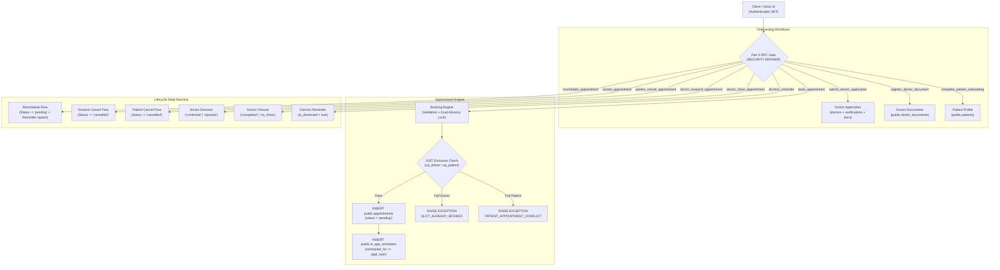
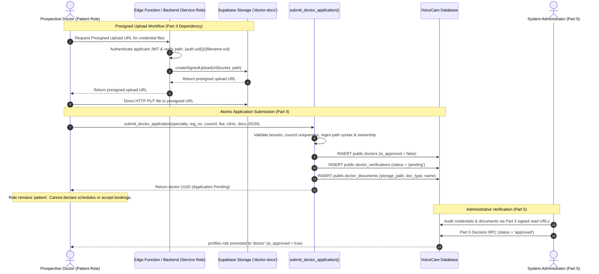
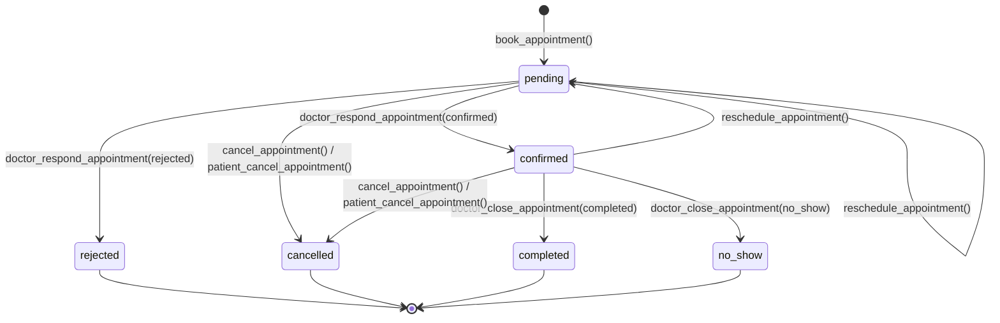

# VoiceCare Phase 2 — Part 4: Appointment Engine & Doctor Onboarding RPCs
## Architectural Specification & Technical Design Document

**Status:** APPROVED DESIGN & SPECIFICATION — NOT YET EXECUTED IN SUPABASE  
**Target Environment:** PostgreSQL 15+ / Supabase Backend  
**Application Scope:** VoiceCare Multilingual Healthcare Platform (India)  
**Author:** Senior Supabase & PostgreSQL Security Architecture Team  

---

## 1. Executive Summary & Architectural Scope

VoiceCare is a voice-first, multilingual healthcare appointment booking platform designed for the Indian healthcare ecosystem. Phase 2 develops the production database infrastructure across seven modular parts:
- **Part 1 (Approved):** Database Foundation Schema (Tables, Enums, GiST Exclusion Constraints, B-Tree & Functional Indexes).
- **Part 2 (Approved):** Authentication, Role Architecture, Profiles, and Table-Level Row Level Security.
- **Part 3 (Approved):** Private Supabase Storage Architecture for Doctor Verification Credentials (`doctor-docs`).
- **Part 4 (Current Deliverable):** **Appointment Engine & Doctor Onboarding Transactional RPCs.**
- **Part 5 (Future):** Administrator Verification Portal & Trusted Review Decision RPCs.
- **Part 6 (Future):** Database-Triggered Webhooks & Real-Time Sync.
- **Part 7 (Future):** Integrated Migration Orchestration, Production Deployment, and Verification.

### 1.1 Scope of Part 4
In Part 2, direct client `INSERT`, `UPDATE`, and `DELETE` privileges on `public.appointments`, `public.in_app_reminders`, `public.doctors`, and `public.doctor_verifications` were **explicitly revoked** from `PUBLIC`, `anon`, and `authenticated`. Part 4 provides the **strictly vetted, server-side `SECURITY DEFINER` Remote Procedure Calls (RPCs)** that govern all state mutations:
1. **Doctor Onboarding Pipeline:** Atomic registration of doctor profile, verification record, and document metadata while maintaining strict role immutability.
2. **Patient Onboarding Pipeline:** Structured demographic enrollment, Indian phone formatting, case-normalized gender, authoritative DOB-driven age calculation, and dynamic age snapshot resolution.
3. **Appointment Booking Engine:** High-concurrency appointment creation with schedule matching, doctor leave verification, timezone anchoring (`Asia/Kolkata`), pediatric/adult age snapshotting as of consultation date, dual advisory locks, and atomic reminder creation.
4. **Appointment Lifecycle State Machine:** Rescheduling with atomic reminder upsert, cancellation (including patient-specific and clinical cancellations), doctor confirmation/rejection (requiring non-empty rejection reason), consultation completion, and no-show processing.
5. **Concurrency & Race Condition Defenses:** Two-tier concurrency control combining transaction-level advisory locks with GiST temporal range exclusion constraints, disambiguating doctor and patient conflicts, plus row locks for document quota serialization.



---

## 2. Role-Based Access Model & Threat Defenses

Part 4 strictly honors the authentication primitives and security boundaries established in Part 2 and Part 3:

### 2.1 Threat Mitigation Matrix

| Threat / Attack Vector | Vulnerability Mechanism | Part 4 Mitigation Strategy |
| :--- | :--- | :--- |
| **Self-Promotion to Doctor** | Untrusted client calls API to set `profiles.role = 'doctor'` | `submit_doctor_application` **never alters `profiles.role`**. The applicant retains `role = 'patient'` until Part 5 Admin approval. `protect_profile_role()` trigger blocks any unauthorized role alteration. |
| **Duplicate Doctor Applications** | User spams onboarding RPC to bypass reviews or generate duplicate profiles | RPC enforces `NOT EXISTS` checks against `public.doctors` and `public.doctor_verifications` for `auth.uid()`, failing closed with `DUPLICATE_DOCTOR_APPLICATION`. |
| **Credential Collision / Fraud** | Disbarred or duplicate medical registration number submitted across multiple accounts | Enforces Indian Medical Council uniqueness: `(registration_number, issuing_authority)` must not exist on any existing application. |
| **Bypassing Unapproved Doctor Status** | Patient books an unverified or suspended doctor | `book_appointment` strictly verifies `is_approved = true AND is_active = true` on `public.doctors`. |
| **Suspended Doctor Action Bypass** | Deactivated or unapproved doctor confirms/closes appointments | `doctor_respond_appointment` and `doctor_close_appointment` verify `is_approved = true AND is_active = true`. |
| **Double Booking / Race Condition** | Two patients simultaneously click "Book" for the exact same slot | **Two-tier concurrency defense:** (1) Dual transaction-level advisory locks serialize callers on doctor and patient slot hashes; (2) GiST temporal exclusion constraint `uq_doctor_no_appointment_overlap` guarantees zero overlaps at the physical storage layer. |
| **Patient Concurrent Overbooking** | Patient books two different doctors for overlapping time slots | Enforces `uq_patient_no_appointment_overlap` GiST exclusion constraint and intercepts with `PATIENT_APPOINTMENT_CONFLICT`. |
| **Document Quota Race Condition** | Concurrent file registration bypasses the 25-document ceiling | `register_doctor_document` acquires a row-level lock (`SELECT ... FOR UPDATE`) on `public.doctors` before counting documents. |
| **Doctor Self-Booking Abuse** | Doctor books themselves to manipulate reviews or availability | Explicit guard `IF p_doctor_id = v_patient_id THEN RAISE EXCEPTION 'SELF_BOOKING_NOT_ALLOWED'`. |
| **Timezone Booking Drift** | Client evaluates dates in UTC or browser local time, booking past slots in India | All temporal validations and schedule matching are anchored to Indian Standard Time (`Asia/Kolkata`). |
| **Tampering with Other Users' Bookings** | Patient A attempts to cancel or reschedule Patient B's appointment | RPC verifies `v_appt.patient_id = auth.uid() OR public.is_admin()`. Unrelated callers receive `UNAUTHORIZED_APPOINTMENT_MODIFICATION`. |
| **Unauthorized Patient Cancellation Bypass** | Unauthenticated or mismatched client attempts to cancel a patient's booking | `patient_cancel_appointment` strictly enforces `v_appt.patient_id = auth.uid() OR public.is_admin()`, rejecting unauthorized callers with `PATIENT_CANCEL_UNAUTHORIZED`. |
| **Premature Appointment Closure** | Doctor marks appointment as completed before consultation starts | `doctor_close_appointment` asserts that consultation start time has arrived in IST (`APPOINTMENT_NOT_YET_STARTED`). |
| **Retroactive Confirmation or Rejection** | Doctor confirms or declines a pending appointment after slot has passed | `doctor_respond_appointment` checks slot start against IST current time, failing with `CANNOT_RESPOND_PAST_APPOINTMENT`. |
| **Silent Generic Rejection Substitution**| Doctor declines appointment without stating reason | `doctor_respond_appointment` enforces non-empty, trimmed reason (`REJECTION_REASON_REQUIRED`) up to 500 characters. |
| **Demographic Overwrite Vulnerability** | Calling onboarding with partial parameters erases previously recorded patient data | `complete_patient_onboarding` preserves existing values using `COALESCE(p_col, existing.col)`. |
| **Incomplete Age Declaration** | Client supplies only age value or only age unit | Rejects with `INCOMPLETE_AGE_SPECIFICATION` across onboarding and booking. |

---

## 3. Reconciled Validation Limits & Data Model Standards

All validation rules in SQL, design, and technical notes are fully reconciled with the approved Part 1 database schema and actual frontend requirements:

| Field | Reconciled Standard | Part 1 Database Constraint | Design & Notes Alignment |
| :--- | :--- | :--- | :--- |
| **Consultation Fee** | ₹0 to ₹50,000 INR | `chk_doctors_consultation_fee CHECK (consultation_fee BETWEEN 0 AND 50000)` | Documented as max ₹50,000 (strictly matching Part 1 check constraint). |
| **Qualification** | 1 to 255 characters | `chk_doctors_qualification CHECK (length(trim(qualification)) > 0)` | Length bounded to 1–255 characters across SQL, design, and notes. |
| **Languages** | 1 to 10 languages | `chk_doctors_languages CHECK (cardinality(languages) > 0)` | Array size bounded to 1–10 elements, each string 1–50 characters. |
| **Clinic Name** | 1 to 255 characters | `chk_doctors_clinic_name CHECK (length(trim(clinic_name)) > 0)` | Length bounded to 1–255 characters across SQL, design, and notes. |
| **Issuing Authority** | 1 to 255 characters | `chk_doctor_verifications_issuing_auth CHECK (length(trim(...)) > 0)` | Length bounded to 1–255 characters across SQL, design, and notes. |
| **Gender** | Canonical Title-Case: `'Male'`, `'Female'`, `'Other'`, `'Prefer not to say'` | `chk_patients_gender CHECK (gender IN ('Male', 'Female', 'Other', 'Prefer not to say'))` | SQL accepts case-insensitively, normalizes to Title-case, and stores exact allowed strings. |
| **Emergency Phone** | 10-digit Indian mobile `^[6-9]\d{9}$` | `chk_patients_emergency_phone` | Validated in onboarding and booking snapshot fallbacks. |
| **Patient Age Model** | Months: 0–11; Years: 1–120 | `chk_patients_age` & `chk_patients_age_unit` | Validated strictly across onboarding and booking engine. |
| **Doctor Document Quota**| 1 to 25 files per doctor | Enforced via serialized row lock in `register_doctor_document` | Max 25 documents per doctor account. |

---

## 4. Patient Age and Date-of-Birth Consistency Architecture

### 4.1 Ten Core Rules for Age and DOB Consistency
1. **Authoritative DOB:** If a date of birth (DOB) is available (either provided in the current call or already stored in `public.patients`), it is the single authoritative source for patient age.
2. **Calculation over Declared Age:** When DOB is available, calculate the patient's age dynamically from DOB rather than trusting a conflicting declared age.
3. **Strict Age-Pair Completeness:** If the caller supplies only one of `p_age_value` or `p_age_unit`, the request is immediately rejected with `INCOMPLETE_AGE_SPECIFICATION`. Incomplete age pairs are never silently accepted.
4. **Stored DOB Retention on Partial Updates:** If DOB is already stored and the patient updates other profile fields (e.g., blood group or medical notes) without supplying DOB again, the stored DOB is retained and age is recalculated from it.
5. **Declared Age Acceptance:** If DOB is completely unavailable, accept a valid declared age and unit.
6. **No Inferred DOB:** The system never invents, infers, or synthesizes a DOB from a declared age (DOB remains `NULL`).
7. **Appointment Date Snapshot:** When booking (`book_appointment`), the patient's age snapshot is calculated using DOB as of the **appointment date** (not merely the current booking date), accurately recording infant and toddler developmental stages for clinical history.
8. **Snapshot Fallback:** If DOB is unavailable, copy the validated declared age and unit into the appointment snapshot.
9. **Part 1 Age Model Preservation:**
   - Unit `'months'`: magnitude $0 \le \text{value} \le 11$.
   - Unit `'years'`: magnitude $1 \le \text{value} \le 120$.
10. **Validation of Boundaries & Inconsistencies:**
    - DOB must be between `'1900-01-01'` and today in IST (`INVALID_DATE_OF_BIRTH`). Future or impossible dates are rejected.
    - If both DOB and declared age are passed, any discrepancy exceeding calendar rounding ($\pm 1$ unit) is rejected with `INCONSISTENT_AGE_DOB`.

---

## 5. Doctor Onboarding Architecture & Storage Integration

### 5.1 Role Immutability & Separation of Concerns
1. Public registration (`handle_new_user`) creates a profile with `role = 'patient'`.
2. A prospective doctor submits credentials via `submit_doctor_application(...)`.
3. The function atomically executes:
   - Insertion into `public.doctors` with `is_approved = false` and `is_active = true`.
   - Insertion into `public.doctor_verifications` with `status = 'pending'::public.verification_status`.
   - Optional registration of uploaded credential documents in `public.doctor_documents`.
4. **Role Immutability:** The applicant's role in `public.profiles` **remains `'patient'`**. The applicant cannot declare availability schedules or accept appointments until an administrator audits their credentials and issues an approval decision in Part 5.



### 5.2 Part 3 Storage Policy Interaction & Upload Flow
In Part 3, Supabase Storage RLS policy `"doctor_docs: insert own or admin"` checks `public.is_doctor_document_owner(name)`, which allows authenticated users to upload files provided:
```sql
split_part(name, '/', 1) = auth.uid()::text
AND (is_doctor OR has_doctor_record OR role = 'patient')
```
- **Prospective Applicant Upload:** Prospective applicants holding `role = 'patient'` can upload credential files directly to their personal folder `{auth.uid()}/...` in `doctor-docs`. Cross-user path tampering is strictly blocked by the folder ownership check.
- **Edge Function Support (`create-doctor-upload-url`):** Alternatively, applicants can request a presigned upload URL via the `create-doctor-upload-url` Edge Function (`supabase/functions/create-doctor-upload-url/index.ts`), which validates file metadata and returns a time-limited signed upload URL.
- **Atomic Metadata Registration:** Once files are uploaded to Storage, the applicant calls `submit_doctor_application` (or `register_doctor_document`), which executes as `SECURITY DEFINER` and records the metadata in `public.doctor_documents`.
- **Approval Lifecycle:** Once approved by an administrator in Part 5, `profiles.role` is promoted to `'doctor'` and `doctors.is_approved` becomes `true`.

### 5.3 Concurrency-Safe Document Quota Enforcement
In `register_doctor_document()`, checking document count without locking allows race conditions where concurrent requests exceed the 25-document limit. Part 4 enforces:
```sql
-- Acquire row-level lock on the doctor's record to serialize document registration
PERFORM 1 FROM public.doctors WHERE id = v_target_id FOR UPDATE;
IF NOT FOUND THEN
    RAISE EXCEPTION 'Doctor profile not found for ID % (code: DOCTOR_NOT_FOUND)', v_target_id;
END IF;

-- Count under row lock
SELECT count(*) INTO v_doc_count FROM public.doctor_documents WHERE doctor_id = v_target_id;
IF v_doc_count >= 25 THEN
    RAISE EXCEPTION 'Maximum document limit (25) reached for this doctor account (code: DOCUMENT_LIMIT_EXCEEDED)';
END IF;
```
Because `SELECT ... FOR UPDATE` serializes concurrent transactions on the parent doctor record, subsequent requests block until the earlier registration commits, guaranteeing that the count check is strictly serial and the 25-document ceiling cannot be bypassed.

---

## 6. Appointment Booking & Rescheduling Engine

### 6.1 Timezone Standardization (`Asia/Kolkata`)
India Standard Time (IST) operates strictly at $\text{UTC}+05:30$ without Daylight Saving Time.
- All temporal validations evaluate current time anchored strictly to IST:
  ```sql
  v_current_ist_timestamp := (now() AT TIME ZONE 'Asia/Kolkata');
  v_current_ist_date      := v_current_ist_timestamp::date;
  v_current_ist_time      := v_current_ist_timestamp::time;
  ```
- Rejections:
  - `p_appointment_date < v_current_ist_date`: Immediate rejection (`APPOINTMENT_DATE_PAST`).
  - `p_appointment_date = v_current_ist_date AND p_appointment_time <= v_current_ist_time`: Immediate rejection (`APPOINTMENT_TIME_PAST`).
  - `p_appointment_date > (v_current_ist_date + INTERVAL '90 days')::date`: Immediate rejection (`APPOINTMENT_DATE_TOO_FAR`).

### 6.2 Availability Checks & Slot Alignment Arithmetic
1. **Approval & Active Verification:** Requires `is_approved = true AND is_active = true` on `public.doctors` (`DOCTOR_NOT_AVAILABLE`).
2. **Leave Verification:** Ensures no record exists in `public.doctor_leaves` for `(doctor_id, appointment_date)` (`DOCTOR_ON_LEAVE`).
3. **Schedule Verification:** Matches day of week ($\text{DOW} \in [0..6]$) in `public.doctor_schedules`, ensuring requested slot fits within operating hours (`OUTSIDE_DOCTOR_SCHEDULE`).
4. **Exact Slot Alignment:** Validates that requested time aligns with slot intervals:
   $$\Delta_{\text{minutes}} = \frac{\text{p\_appointment\_time} - \text{start\_time}}{60 \text{ seconds}}$$
   $$\Delta_{\text{minutes}} \pmod{\text{slot\_duration\_minutes}} \equiv 0 \implies \text{RAISE } \text{INVALID\_SLOT\_ALIGNMENT}$$

### 6.3 Concurrency Control & Dual Exclusion Interception
VoiceCare employs a **two-tiered concurrency defense**:
1. **Tier 1 (Dual Application Advisory Locks):**
   - Doctor slot serialization: `pg_advisory_xact_lock(hashtext('doctor_slot:' || p_doctor_id || ':' || p_appointment_date || ':' || p_appointment_time))`
   - Patient slot serialization: `pg_advisory_xact_lock(hashtext('patient_slot:' || v_patient_id || ':' || p_appointment_date || ':' || p_appointment_time))`
2. **Tier 2 (PostgreSQL GiST Physical Exclusion Constraints):**
   - Intercepts `exclusion_violation` (`23P01`) using `GET STACKED DIAGNOSTICS v_constraint_name = CONSTRAINT_NAME`.
   - Disambiguates between doctor conflict (`SLOT_ALREADY_BOOKED`) and patient simultaneous booking conflict (`PATIENT_APPOINTMENT_CONFLICT`).

### 6.4 Reliable Reminder Lifecycle & Rescheduling Upsert
- **Booking Reminder Creation:**
  $$\text{Scheduled For} = \min(\text{computed\_lead\_time}, \text{appointment\_start\_utc})$$
  Ensures that short-notice appointments ($<2$h or $<5$m) are never assigned a reminder time after the consultation starts.
- **Rescheduling Atomic Upsert:**
  When `reschedule_appointment` runs, it holds `FOR UPDATE` on `public.appointments`. Under this lock:
  - If an active reminder exists for `(appointment_id, patient_id)`, it updates `scheduled_for = v_new_reminder_ts`, un-sends, and un-dismisses it.
  - If no reminder exists, it inserts a new reminder record.
  - Any obsolete duplicate reminders are dismissed.
  - Strict invariant: $\text{Reminder Time} \le \text{New Appointment Start Time}$.
- **Cancellation Dismissal:**
  Both `cancel_appointment` and `patient_cancel_appointment` set `is_dismissed = true` on associated reminders.

---

## 7. Appointment Lifecycle State Machine

The lifecycle of an appointment is governed by a deterministic finite state machine:



### 7.1 State Transition Matrix & Actor Permissions

| Current Status | Action / RPC | Permitted Actor | Target Status | Pre-Conditions & Operational Rules |
| :--- | :--- | :--- | :--- | :--- |
| **`pending`** | `doctor_respond_appointment('confirmed')` | Assigned Doctor, Admin | **`confirmed`** | Requires `is_approved = true AND is_active = true`. Slot must not be in past (`CANNOT_RESPOND_PAST_APPOINTMENT`). |
| **`pending`** | `doctor_respond_appointment('rejected')` | Assigned Doctor, Admin | **`rejected`** | Requires `is_approved = true AND is_active = true`. Requires non-empty reason (`REJECTION_REASON_REQUIRED`) up to 500 chars. Dismisses reminders. |
| **`pending`** | `cancel_appointment(...)` | Patient, Doctor, Admin | **`cancelled`** | Allowed prior to appointment start time (`CANNOT_CANCEL_PAST_APPOINTMENT`). Dismisses reminders. |
| **`pending`** | `patient_cancel_appointment(...)` | Booking Patient, Admin | **`cancelled`** | Strictly enforces caller is booking patient (`PATIENT_CANCEL_UNAUTHORIZED`). Dismisses reminders. |
| **`pending`** | `reschedule_appointment(...)` | Booking Patient, Admin | **`pending`** | Re-validates schedule/leaves, dual advisory locks, atomic reminder upsert, resets status to pending for doctor re-confirmation. |
| **`confirmed`**| `doctor_close_appointment('completed')` | Assigned Doctor, Admin | **`completed`** | Verifies doctor is approved/active (`DOCTOR_NOT_ACTIVE`). Verifies appointment has started in IST (`APPOINTMENT_NOT_YET_STARTED`). Appends notes, dismisses reminders. |
| **`confirmed`**| `doctor_close_appointment('no_show')` | Assigned Doctor, Admin | **`no_show`** | Verifies doctor is approved/active. Verifies appointment has started in IST. Dismisses reminders. |
| **`confirmed`**| `cancel_appointment(...)` | Patient, Doctor, Admin | **`cancelled`** | Allowed prior to appointment start time. Dismisses reminders. |
| **`confirmed`**| `patient_cancel_appointment(...)` | Booking Patient, Admin | **`cancelled`** | Allowed prior to appointment start time. Dismisses reminders. |
| **`confirmed`**| `reschedule_appointment(...)` | Booking Patient, Admin | **`pending`** | Allowed prior to appointment start time. Reverts to pending for doctor re-confirmation. |
| **`completed`**| *Any Mutation* | *None* | *TERMINAL* | Modification strictly blocked (`CANNOT_CANCEL_CLOSED_APPOINTMENT`). |
| **`rejected`** | *Any Mutation* | *None* | *TERMINAL* | Modification strictly blocked. |
| **`cancelled`**| *Any Mutation* | *None* | *TERMINAL* | Modification strictly blocked. |
| **`no_show`**  | *Any Mutation* | *None* | *TERMINAL* | Modification strictly blocked. |

---

## 8. RPC Function Specifications & Interface Contracts

Every function in Part 4 enforces:
1. `SECURITY DEFINER` execution owned by `postgres`.
2. Hardened search path: `SET search_path = pg_catalog`.
3. Explicit `REVOKE ALL` from `PUBLIC` and `anon`.
4. Explicit `GRANT EXECUTE` to `authenticated`.
5. Standardized exception handling with machine-readable error codes.

### 8.1 Interface Signatures

```sql
-- 1. Doctor Onboarding & Document Registration
public.submit_doctor_application(
    p_specialty TEXT,
    p_qualification TEXT,
    p_experience_years INTEGER,
    p_consultation_fee INTEGER,
    p_languages TEXT[],
    p_bio TEXT,
    p_clinic_name TEXT,
    p_clinic_address TEXT,
    p_registration_number TEXT,
    p_issuing_authority TEXT,
    p_documents JSONB DEFAULT '[]'::jsonb
) RETURNS UUID;

public.register_doctor_document(
    p_document_type TEXT,
    p_document_name TEXT,
    p_storage_path TEXT
) RETURNS UUID;

-- 2. Patient Profile Completion
public.complete_patient_onboarding(
    p_age_value INTEGER DEFAULT NULL,
    p_age_unit TEXT DEFAULT NULL,
    p_gender TEXT DEFAULT NULL,
    p_blood_group TEXT DEFAULT NULL,
    p_emergency_phone TEXT DEFAULT NULL,
    p_medical_notes TEXT DEFAULT NULL,
    p_date_of_birth DATE DEFAULT NULL
) RETURNS UUID;

-- 3. Appointment Booking & Rescheduling
public.book_appointment(
    p_doctor_id UUID,
    p_appointment_date DATE,
    p_appointment_time TIME,
    p_chief_complaint TEXT,
    p_patient_name TEXT DEFAULT NULL,
    p_patient_phone TEXT DEFAULT NULL,
    p_patient_age_value INTEGER DEFAULT NULL,
    p_patient_age_unit TEXT DEFAULT NULL
) RETURNS UUID;

public.reschedule_appointment(
    p_appointment_id UUID,
    p_new_date DATE,
    p_new_time TIME,
    p_reason TEXT DEFAULT NULL
) RETURNS BOOLEAN;

-- 4. Appointment Lifecycle & Reminders
public.cancel_appointment(
    p_appointment_id UUID,
    p_cancellation_reason TEXT DEFAULT 'Cancelled by user'
) RETURNS BOOLEAN;

public.patient_cancel_appointment(
    p_appointment_id UUID,
    p_cancellation_reason TEXT DEFAULT 'Cancelled by patient'
) RETURNS BOOLEAN;

public.doctor_respond_appointment(
    p_appointment_id UUID,
    p_decision TEXT,
    p_reason TEXT DEFAULT NULL
) RETURNS BOOLEAN;

public.doctor_close_appointment(
    p_appointment_id UUID,
    p_outcome TEXT,
    p_consultation_notes TEXT DEFAULT NULL
) RETURNS BOOLEAN;

public.dismiss_reminder(
    p_reminder_id UUID
) RETURNS BOOLEAN;
```

### 8.2 Base Table Privilege Hardening: public.doctor_documents
In Part 2, `GRANT SELECT, INSERT, DELETE ON public.doctor_documents TO authenticated` was originally established before Part 4's transactional RPCs were defined. Under that configuration, an approved doctor could execute `POST /rest/v1/doctor_documents` directly via the Supabase Data API (PostgREST), bypassing `public.register_doctor_document()`, the doctor-row lock, and the 25-document ceiling.

**Part 4 Hardening Correction:**
Part 4 explicitly executes:
```sql
REVOKE INSERT ON public.doctor_documents FROM PUBLIC, anon, authenticated;
```
- Direct client `INSERT` is completely revoked.
- Document metadata creation is routed **exclusively** through the trusted `SECURITY DEFINER` RPCs:
  1. `public.submit_doctor_application()`: Initial onboarding payload (capped at 10 documents).
  2. `public.register_doctor_document()`: Subsequent credential uploads (capped at 25 documents under parent doctor-row lock).
- Direct client `SELECT` and `DELETE` privileges granted in Part 2 are preserved.
- **Part 2 Dependency:** In an integrated production migration (Part 7), Part 2's direct `INSERT` grant on `public.doctor_documents` is superseded by this Part 4 revocation.

---

## 9. Dependencies, Assumptions & Part 5 Hand-off

1. **Unexecuted Migration State:**  
   The SQL files for Parts 1, 2, 3, and 4 have **not** been executed against a live Supabase environment. Part 4 SQL contains strict preflight assertions verifying all predecessor objects exist before applying functions.
2. **PostgreSQL Server Time & NTP:**  
   The system relies on PostgreSQL's `now()` function. Server system clocks must be synchronized via NTP. Timezone conversions use the IANA identifier `'Asia/Kolkata'`.
3. **No Service Role Keys in Client Code:**  
   Frontend clients invoke these functions using the standard Supabase client SDK: `supabase.rpc('book_appointment', { ... })`. Service role keys are never exposed.
4. **Part 5 Hand-off:**  
   Part 4 intentionally halts doctor onboarding at `status = 'pending'`. The final transition to `approved` and the promotion of `profiles.role` to `'doctor'` is reserved exclusively for Part 5 (Admin Verification Portal).
