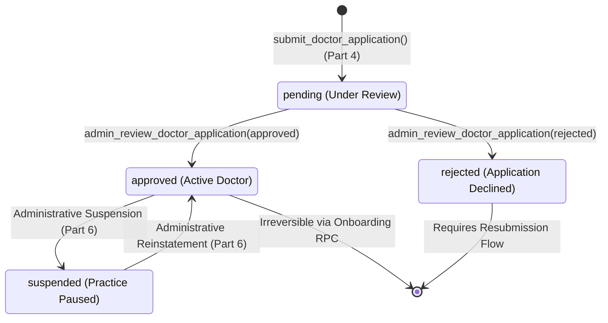
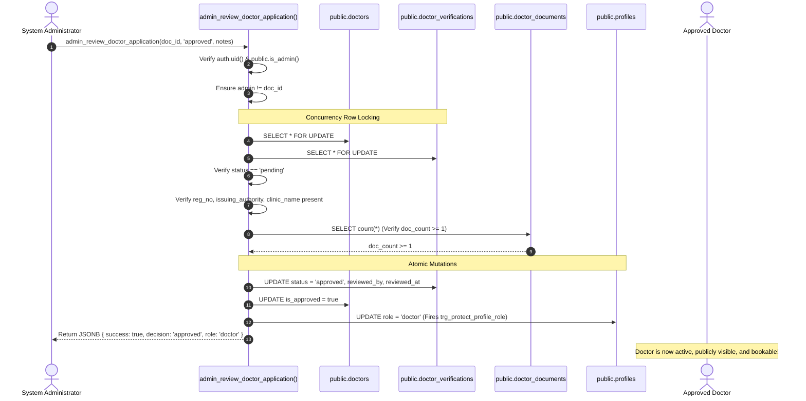
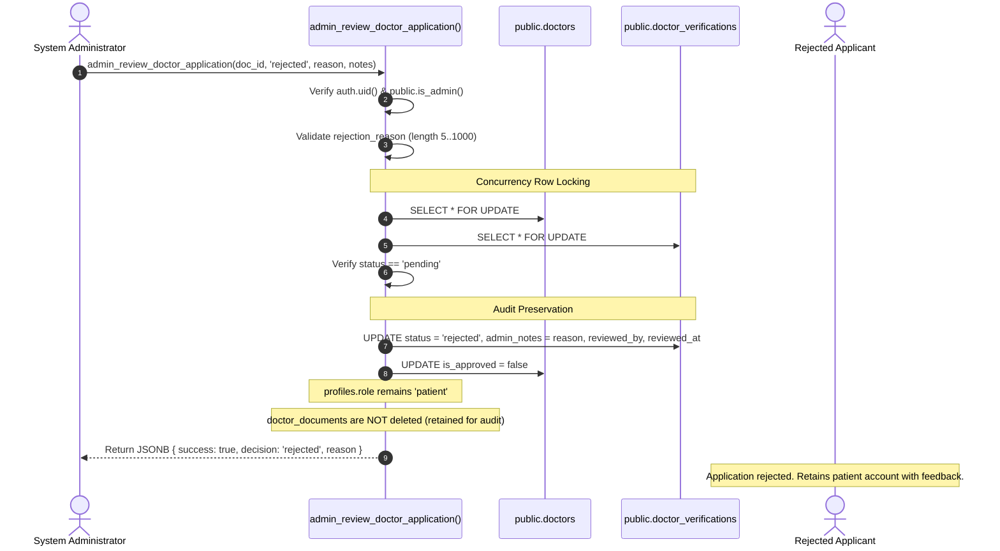

# VoiceCare Phase 2 — Part 5: Admin Review Dashboard & Doctor Verification Workflow Design

**Document:** Architecture Specification, State Machine, Transactional Models & Security Blueprint  
**Status:** APPROVED ARCHITECTURAL DESIGN — NOT YET EXECUTED IN SUPABASE  
**Target Environment:** PostgreSQL 15+ / Supabase Backend / React 19 Frontend  
**Scope:** Part 5 Admin Review Engine, Doctor Approval/Rejection RPCs, Document Viewing & Dashboard UI  

---

## 1. System Context & Objective

In VoiceCare Phase 2, medical practitioners submit onboarding applications through Part 4 (`submit_doctor_application`). To safeguard patient safety, maintain clinical standards, and comply with Indian healthcare regulatory frameworks (National Digital Health Mission / Ayushman Bharat Digital Mission guidelines):
- Unverified doctors cannot self-approve or publish availability schedules.
- Prospective applicants remain with `role = 'patient'` until credentials undergo administrative verification.
- Verification requires inspecting State Medical Council registration certificates, degrees, identity proofs, and clinic credentials.

**Part 5 establishes:**
1. **Transactional Administrative Decision RPC (`admin_review_doctor_application`):** Atomic approval (with profile role promotion to `'doctor'` and directory visibility activation) or rejection (requiring mandatory reasons while preserving audit documents).
2. **Administrative Queue & Search RPCs (`admin_list_doctor_applications`, `admin_get_doctor_application_details`, `admin_get_application_stats`):** Secure querying with pagination and keyword filtering without leaking private patient data.
3. **Secure Document Viewing Service:** Edge Function issuing temporary, short-lived (300s) presigned read URLs from the private `doctor-docs` storage bucket with server-side admin verification and cross-applicant isolation.
4. **React Admin Review Dashboard:** Full-featured, accessible UI with overview metrics, application queue, searchable filtering, credential inspection modal, and confirmation dialogs.

---

## 2. Role Hierarchy & Defense-in-Depth Authorization Model

VoiceCare enforces an uncompromising three-tiered defense against unauthorized administrative access:

```mermaid
flowchart TD
    subgraph ClientLayer["Tier 1: Frontend Client Guard"]
        A["User Navigates to Admin Route"] --> B{"useAdminAuth Hook"}
        B -->|Authenticated & Role = admin| C["Render AdminDashboard"]
        B -->|Unauthenticated or Non-Admin| D["Redirect / Access Denied Gate"]
    end

    subgraph RPCLayer["Tier 2: Backend Database RPC Guard"]
        C --> E["Invoke Part 5 Admin RPCs"]
        E --> F{"auth.uid() IS NOT NULL?"}
        F -->|No| G["401 AUTH_REQUIRED"]
        F -->|Yes| H{"public.is_admin()?"}
        H -->|No| I["403 ADMIN_REQUIRED"]
        H -->|Yes| J{"Admin == Target Doctor?"}
        J -->|Yes| K["403 ADMIN_SELF_REVIEW_PROHIBITED"]
        J -->|No| L["Proceed to Transaction"]
    end

    subgraph TriggerLayer["Tier 3: Table Trigger & DDL Guard"]
        L --> M["UPDATE public.profiles SET role = 'doctor'"]
        M --> N{"trg_protect_profile_role"}
        N -->|Caller is_admin() & auth.uid() != target| O["Permit Role Mutation & Commit"]
        N -->|Non-Admin Direct API Update| P["Abort: 42501 ROLE_LOCK"]
    end
```

### Authorization Invariants
1. **Frontend Role Checks Are Never Trusted in Isolation:** Even if an attacker modifies client-side JavaScript or bypasses React routing, all backend RPCs verify `public.is_admin()`.
2. **Self-Review Prohibited:** An administrator cannot review their own application (`v_admin_id = p_doctor_id`), preventing conflict of interest and bypassing `SELF_ROLE_LOCK`.
3. **No Direct DML on Roles:** Direct updates on `public.profiles.role` by clients are blocked by `trg_protect_profile_role`. Role promotion is exclusively triggered within the trusted `admin_review_doctor_application` transaction.

---

## 3. Application Lifecycle & State Machine

The verification status of a doctor application is strictly governed by the `public.verification_status` finite state machine:



### State Transition Validation Matrix

| Current Status | Target Decision | Allowed? | Error Code / Result | Database Effects |
| :--- | :--- | :---: | :--- | :--- |
| **`pending`** | `approved` | **YES** | `success: true` | `status = 'approved'`, `doctors.is_approved = true`, `profiles.role = 'doctor'` |
| **`pending`** | `rejected` | **YES** | `success: true` | `status = 'rejected'`, `doctors.is_approved = false`, `profiles.role = 'patient'`, reason recorded |
| **`approved`** | `approved` | **NO** | `ALREADY_APPROVED` | Transaction rolled back |
| **`approved`** | `rejected` | **NO** | `CANNOT_REJECT_APPROVED_DOCTOR` | Transaction rolled back (must use Part 6 suspension) |
| **`rejected`** | `approved` | **NO** | `CANNOT_APPROVE_REJECTED_APPLICATION` | Transaction rolled back (requires formal re-application) |
| **`rejected`** | `rejected` | **NO** | `ALREADY_REJECTED` | Transaction rolled back |
| **`suspended`**| *Any* | **NO** | `ACCOUNT_SUSPENDED` | Transaction rolled back |

---

## 4. Transactional Adjudication Workflows

### 4.1 Approval Sequence (`admin_review_doctor_application('approved')`)



### 4.2 Rejection Sequence (`admin_review_doctor_application('rejected')`)



---

## 5. Secure Verification Document Viewing Architecture

Practitioner medical licenses, degrees, and identity proofs reside in the private `doctor-docs` Supabase Storage bucket (`public = false`). Direct public URLs return 404/403.

### Document Viewing Flow
1. **Frontend Request:** Admin clicks "View Document" on the application modal. React calls Edge Function `create-doctor-document-view-url` with caller's Bearer JWT and payload `{ doctorId, documentId }`.
2. **Edge Function Authentication:** Edge Function calls `auth.getUser()`, validates the session, queries `public.profiles.role`, and asserts `role === 'admin'`.
3. **Application Ownership & Path Sanity:**
   - Queries `public.doctor_documents` for `id = documentId AND doctor_id = doctorId`.
   - Validates that `storage_path` matches `{doctorId}/{filename.ext}` and contains zero traversal sequences (`..`).
4. **Temporary Presigned Read URL Generation:**
   - Calls Supabase Storage Admin API:
     ```typescript
     const { data, error } = await adminClient.storage
       .from("doctor-docs")
       .createSignedUrl(doc.storage_path, 300); // 300 seconds (5 min) TTL
     ```
5. **Client Rendering:** Frontend opens the temporary signed URL in a secure, isolated preview tab (`rel="noopener noreferrer"`).
6. **Zero Leaks:** The service role key is never returned to the browser; signed URLs expire automatically after 5 minutes.

---

## 6. Standardized Error Code Dictionary

| Error Code | Trigger Condition | HTTP / Exception Text | Recommended User Action |
| :--- | :--- | :--- | :--- |
| `AUTH_REQUIRED` | `auth.uid() IS NULL` | Authentication required to access administrative functions | Re-authenticate with admin credentials. |
| `ADMIN_REQUIRED` | `NOT public.is_admin()` | Access denied: caller does not possess administrator privileges | Access restricted to administrators only. |
| `ADMIN_SELF_REVIEW_PROHIBITED` | `auth.uid() = p_doctor_id` | Administrators cannot review their own doctor application | Use a different administrator account. |
| `DECISION_REQUIRED` | `p_decision IS NULL` | Review decision is mandatory | Select 'approved' or 'rejected'. |
| `INVALID_DECISION` | `p_decision NOT IN ('approved', 'rejected')` | Invalid review decision. Permitted values: approved, rejected | Select valid decision. |
| `ADMIN_NOTES_TOO_LONG` | `length(p_admin_notes) > 2000` | Admin notes cannot exceed 2000 characters | Shorten internal administrative notes. |
| `DOCTOR_NOT_FOUND` | Missing row in `public.doctors` | Doctor application record not found for ID | Verify doctor ID link. |
| `VERIFICATION_RECORD_NOT_FOUND` | Missing row in `public.doctor_verifications` | Doctor verification record not found for doctor ID | Contact system engineering. |
| `ALREADY_APPROVED` | `v_verification.status = 'approved'` | Application has already been approved | Doctor is already active. |
| `CANNOT_REJECT_APPROVED_DOCTOR` | Attempt to reject approved doctor | Cannot reject an already approved doctor through onboarding review | Use Part 6 suspension workflow. |
| `ALREADY_REJECTED` | `v_verification.status = 'rejected'` | Application has already been rejected | Application already declined. |
| `CANNOT_APPROVE_REJECTED_APPLICATION` | Attempt to approve rejected application | Cannot approve a rejected application without formal resubmission | Require doctor to re-apply. |
| `ACCOUNT_SUSPENDED` | `v_verification.status = 'suspended'` | Account is currently suspended | Use Part 6 administrative reinstatement. |
| `INVALID_APPLICATION_STATUS` | Status is not `'pending'` | Application is not in pending status | Only pending applications can be reviewed. |
| `MISSING_REGISTRATION_NUMBER` | Empty or null registration number | Cannot approve doctor without medical registration number | Verify credentials before approval. |
| `MISSING_ISSUING_AUTHORITY` | Empty or null issuing council | Cannot approve doctor without issuing medical council authority | Verify council before approval. |
| `MISSING_CLINIC_DETAILS` | Empty clinic name | Cannot approve doctor without valid clinic or practice details | Ensure clinic details exist. |
| `MISSING_VERIFICATION_DOCUMENTS` | `document_count == 0` | Cannot approve doctor application without at least one submitted document | Verify credential documents. |
| `REJECTION_REASON_REQUIRED` | Rejection reason is empty/whitespace | Mandatory rejection reason required when declining doctor application | Provide descriptive clinical/legal reason. |
| `REJECTION_REASON_TOO_SHORT` | Rejection reason $< 5$ chars | Rejection reason must be at least 5 characters in length | Provide detailed reason for applicant. |
| `REJECTION_REASON_TOO_LONG` | Rejection reason $> 1000$ chars | Rejection reason cannot exceed 1000 characters | Shorten rejection reason. |

---

## 7. React Admin Dashboard Architecture

The Admin Review Dashboard is structured using modular, reusable components adhering to VoiceCare's design tokens and accessibility standards:

```text
src/components/admin/
├── AdminDashboard.tsx           # Primary dashboard screen (metrics, queue, filters)
├── ApplicationQueueTable.tsx    # Responsive table/cards with status badges & actions
├── ApplicationDetailModal.tsx   # Comprehensive credential inspector modal
├── ApprovalConfirmModal.tsx     # Double-confirmation modal before approving
├── RejectionReasonModal.tsx     # Mandatory reason modal before rejecting
└── AdminLoginModal.tsx          # Secure administrator sign-in gate
```

### Key UI Features
- **Metric Cards:** Pending Applications (Amber), Approved Doctors (Emerald), Rejected Applications (Rose), Total Applications (Blue).
- **Search & Filters:** Real-time search across doctor full name, registration number, or clinic name; status filter tabs (`All`, `Pending`, `Approved`, `Rejected`).
- **Interactive Review Modal:** Displays doctor contact, specialty, qualifications, experience, fees, clinic information, and submitted document cards.
- **Accessible State Handling:** Loading spinners, empty states, error notifications, and high-contrast accessible buttons.
