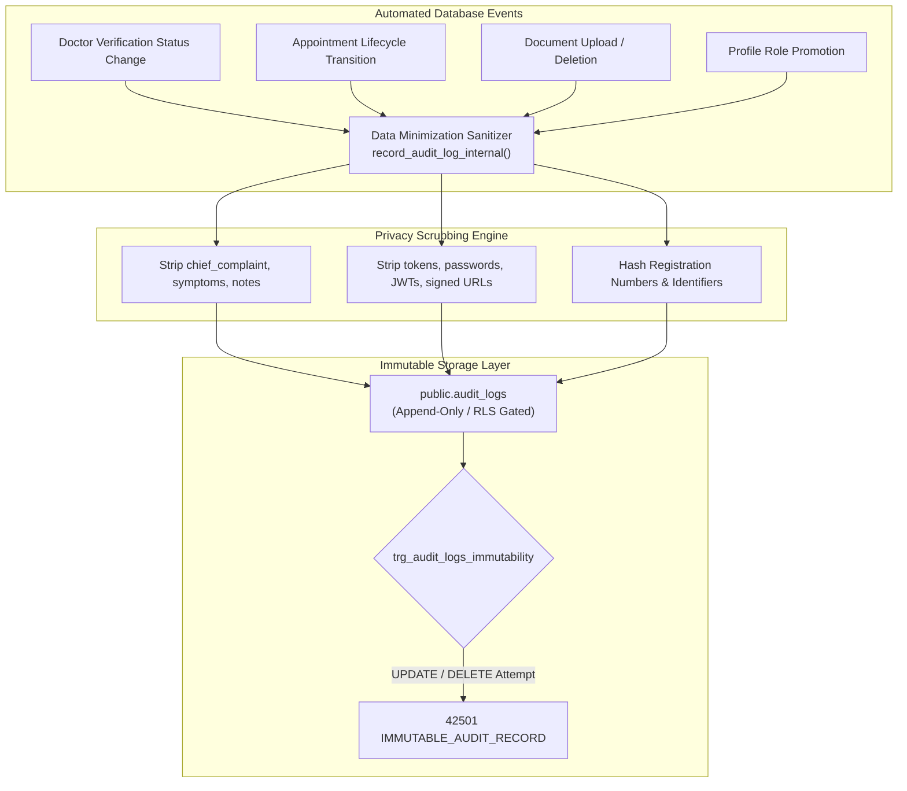
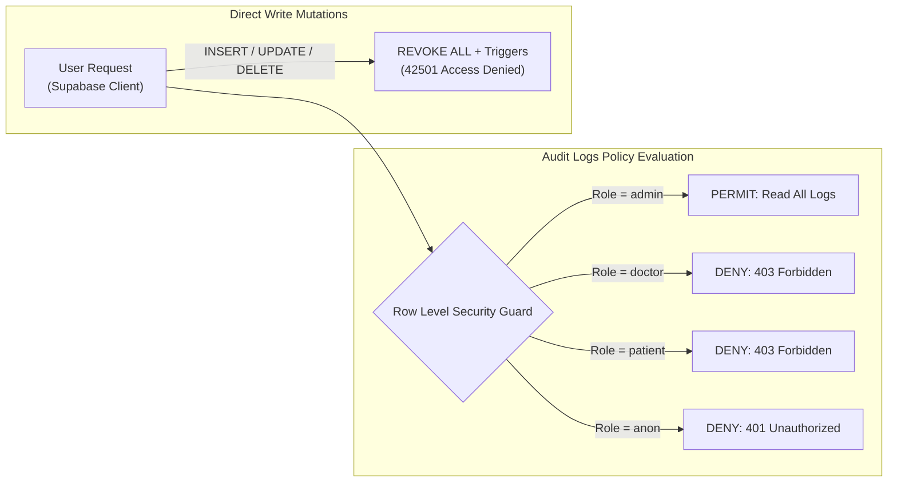

# VoiceCare Phase 2 — Part 6: Audit Logging, Telemetry and Compliance Design

**Document:** Architectural Specification, Audit Taxonomy, Data Minimization & Compliance Blueprint  
**Status:** APPROVED ARCHITECTURAL DESIGN — NOT YET EXECUTED IN SUPABASE  
**Target Environment:** PostgreSQL 15+ / Supabase Backend  
**Scope:** Part 6 Audit Trail, Operational Telemetry, Immutability Guards, and Retention Framework  

---

## 1. System Context & Objective

In healthcare appointment and telemedicine platforms, audit logging serves dual functions: regulatory compliance and system observability. However, capturing audit events in a clinical context presents significant privacy and security challenges:
- **Clinical Privacy Risk:** Naive database audit logs often copy complete row images, unintentionally persisting sensitive patient health information (PHI) such as symptoms, chief complaints, and consultation notes into secondary tables.
- **Tampering Hazard:** In untrusted or multi-administrator environments, malicious or compromised accounts could attempt to alter or delete historical audit entries to obscure unauthorized activities.
- **Regulatory Requirements:** Platforms operating in India must navigate the Digital Personal Data Protection Act, 2023 (DPDP Act 2023), the Information Technology Act, 2000 (and associated CERT-In cybersecurity directives), and the National Medical Commission (NMC) regulations.

**Part 6 establishes:**
1. **Append-Only Immutable Audit Trail (`public.audit_logs`):** A dedicated, append-only table recording security-critical, administrative, and appointment lifecycle events, guarded against `UPDATE` and `DELETE` at the database engine level.
2. **Privacy-by-Design & Data Minimization:** Rigorous sanitization routines ensuring that clinical complaints, medical notes, passwords, auth tokens, and temporary URLs are strictly stripped before audit persistence.
3. **Automated Event Capture Triggers:** Database triggers on `doctor_verifications`, `appointments`, `doctor_documents`, and `profiles` that capture all lifecycle transitions automatically, regardless of whether operations originate from Part 4/5 RPCs or direct administrative interactions.
4. **Operational Telemetry (`public.operational_telemetry`):** Sanitized operational error reporting and component diagnostic metrics, isolated from business audit data.
5. **Administrative Query Interfaces:** Secure, paginated, and filtered `SECURITY DEFINER` RPCs granting administrators read-only access to audit logs and telemetry statistics.
6. **Retention & Compliance Framework:** A documented policy distinguishing verified statutory obligations from internal platform data retention schedules.

---

## 2. Audit Event Taxonomy & Data Minimization Architecture

VoiceCare enforces strict **privacy-by-design** and **data minimization** principles in compliance with Section 6 and Section 8 of the DPDP Act 2023.



### 2.1 Audit Event Taxonomy

| Event Type | Triggering Source | Resource Type | Actor Role | Captured Metadata (Sanitized) | Excluded Data (Data Minimization) |
| :--- | :--- | :--- | :--- | :--- | :--- |
| `doctor_application_submitted` | `public.doctor_verifications` (INSERT) | `doctor_verification` | `patient` / `system` | Doctor UUID, registration hash, issuing council, initial status | Bio text, personal phone, home address |
| `doctor_application_approved` | `public.doctor_verifications` (UPDATE) | `doctor_verification` | `admin` | Doctor UUID, old/new status, reviewer UUID, timestamp | Clinical credentials, degree certificates |
| `doctor_application_rejected` | `public.doctor_verifications` (UPDATE) | `doctor_verification` | `admin` | Doctor UUID, old/new status, reviewer UUID, boolean `has_admin_notes` | Specific unredacted applicant private notes |
| `doctor_application_suspended` | `public.doctor_verifications` (UPDATE) | `doctor_verification` | `admin` | Doctor UUID, old/new status, reviewer UUID | Private dispute correspondence |
| `appointment_booked` | `public.appointments` (INSERT) | `appointment` | `patient` | Doctor UUID, patient UUID, appointment date, slot time, status | **`chief_complaint`**, patient name, phone |
| `appointment_rescheduled` | `public.appointments` (UPDATE) | `appointment` | `patient` / `admin` | Doctor UUID, patient UUID, old date/time, new date/time | Reason text containing personal details |
| `appointment_confirmed` | `public.appointments` (UPDATE) | `appointment` | `doctor` / `admin` | Doctor UUID, patient UUID, old/new status | Clinical notes |
| `appointment_rejected` | `public.appointments` (UPDATE) | `appointment` | `doctor` / `admin` | Doctor UUID, patient UUID, old/new status, boolean `has_cancellation_reason` | Patient symptoms |
| `appointment_cancelled` | `public.appointments` (UPDATE) | `appointment` | `patient` / `doctor` / `admin` | Doctor UUID, patient UUID, old/new status, cancellation indicator | Patient symptoms |
| `appointment_completed` | `public.appointments` (UPDATE) | `appointment` | `doctor` | Doctor UUID, patient UUID, completion timestamp | **`consultation_notes`**, prescriptions |
| `appointment_no_show` | `public.appointments` (UPDATE) | `appointment` | `doctor` | Doctor UUID, patient UUID, no-show timestamp | Clinical notes |
| `doctor_document_uploaded` | `public.doctor_documents` (INSERT) | `doctor_document` | `patient` / `doctor` | Doctor UUID, document type, file size bytes, MIME type | Raw binary, storage signed URL |
| `doctor_document_deleted` | `public.doctor_documents` (DELETE) | `doctor_document` | `doctor` / `admin` | Doctor UUID, document type | Storage physical path |
| `profile_role_changed` | `public.profiles` (UPDATE) | `profile` | `admin` / `system` | Target profile UUID, old role, new role | Profile email, personal name |

---

## 3. Append-Only Immutability Architecture

To guarantee non-repudiation and prevent audit log tampering:

1. **Database-Level Trigger Blockers:**
   Both `public.audit_logs` and `public.operational_telemetry` are protected by `BEFORE UPDATE OR DELETE` triggers executing `public.prevent_audit_log_tampering()`:
   ```sql
   CREATE OR REPLACE FUNCTION public.prevent_audit_log_tampering()
   RETURNS TRIGGER
   LANGUAGE plpgsql
   SECURITY DEFINER
   SET search_path = pg_catalog
   AS $$
   BEGIN
       RAISE EXCEPTION 'Audit records and telemetry entries are strictly append-only and cannot be modified or deleted (code: IMMUTABLE_AUDIT_RECORD)'
           USING ERRCODE = '42501';
       RETURN NULL;
   END;
   $$;
   ```
2. **Zero Client Privileges:**
   All `INSERT`, `UPDATE`, and `DELETE` grants on audit tables are revoked from `PUBLIC`, `anon`, and `authenticated`.
3. **Controlled Internal Ingestion:**
   Inserts into `public.audit_logs` are routed exclusively through the internal `SECURITY DEFINER` routine `public.record_audit_log_internal()`, which executes with `postgres` ownership and sanitizes all incoming payloads.

---

## 4. Operational Telemetry Architecture

To avoid polluting the legal/compliance audit trail with high-frequency operational metrics or transient debugging data, VoiceCare separates operational telemetry into `public.operational_telemetry`:

- **Isolation:** Telemetry captures application execution events, RPC failures, storage deletion queue progress, and component latency without impacting audit record indexing.
- **Severity Levels:** Restricted to standard operational categories: `'info'`, `'warning'`, `'error'`, `'critical'`.
- **Sanitization:** Cleansed of any query strings, authorization headers, passwords, or patient medical identifiers.
- **Ingestion Interface:** Exposed via `public.record_telemetry_event(...)`, enabling client error boundaries and Edge Functions to report operational health metrics securely.

---

## 5. Access Control & Row Level Security (RLS)

VoiceCare enforces an uncompromising least-privilege security model on audit and telemetry tables:



- **Ordinary Patients and Doctors:** Have zero access to `public.audit_logs` or `public.operational_telemetry`. They cannot list, search, or inspect platform audit records.
- **Administrators:** Read access is permitted exclusively through Row Level Security:
  ```sql
  CREATE POLICY "audit_logs: admin read only"
      ON public.audit_logs
      FOR SELECT
      TO authenticated
      USING (public.is_admin() = true);
  ```
- **Administrative RPCs:** Administrators interact with audit records through hardened `SECURITY DEFINER` functions that verify `public.is_admin()`, paginate results, and provide structured search without raw table exposure.

---

## 6. Administrative RPC Interfaces & Query Contracts

All administrative functions enforce:
1. `SECURITY DEFINER` with `SET search_path = pg_catalog`.
2. Caller validation: `auth.uid() IS NOT NULL AND public.is_admin()`.
3. Bounded pagination: `p_limit` bounded to 1–100 (default 50).

### 6.1 Function Signatures

```sql
-- 1. Paginated Audit Log Search & Filter
public.admin_list_audit_logs(
    p_event_type TEXT DEFAULT NULL,
    p_actor_id UUID DEFAULT NULL,
    p_resource_id UUID DEFAULT NULL,
    p_resource_type TEXT DEFAULT NULL,
    p_from_date TIMESTAMPTZ DEFAULT NULL,
    p_to_date TIMESTAMPTZ DEFAULT NULL,
    p_limit INT DEFAULT 50,
    p_offset INT DEFAULT 0
) RETURNS JSONB;

-- 2. Audit Event Aggregation & Volume Distribution
public.admin_get_audit_stats(
    p_timeframe_days INT DEFAULT 30
) RETURNS JSONB;

-- 3. Operational Telemetry & Error Query
public.admin_list_telemetry_events(
    p_severity TEXT DEFAULT NULL,
    p_component TEXT DEFAULT NULL,
    p_from_date TIMESTAMPTZ DEFAULT NULL,
    p_limit INT DEFAULT 50,
    p_offset INT DEFAULT 0
) RETURNS JSONB;

-- 4. 24-Hour Operational Health Diagnostics
public.admin_get_telemetry_summary()
RETURNS JSONB;

-- 5. Client & Edge Function Telemetry Ingestion
public.record_telemetry_event(
    p_component TEXT,
    p_event_name TEXT,
    p_severity TEXT DEFAULT 'info',
    p_error_code TEXT DEFAULT NULL,
    p_telemetry_data JSONB DEFAULT '{}'::jsonb
) RETURNS UUID;
```

---

## 7. Retention & Purging Policy Framework

A critical requirement of Part 6 is to **clearly distinguish statutory obligations from internal product retention policies**.

### 7.1 Statutory Obligations (Governing Laws in India)

| Regulation / Directive | Authority | Legal Mandate | Platform Application |
| :--- | :--- | :--- | :--- |
| **CERT-In Cyber Security Directions (April 2022)** | Indian Computer Emergency Response Team (MeitY) | Direction No. 20(3)/2022-CERT-In mandates that all intermediaries, service providers, and data centres **maintain ICT system logs for a rolling period of 180 days** within Indian jurisdiction. | System and access logs must be preserved for at least 180 days. Deleting system logs before 180 days is a regulatory violation. |
| **Digital Personal Data Protection Act, 2023 (DPDP Act)** | Parliament of India | **Section 8(7):** Data fiduciaries must erase personal data upon purpose completion or withdrawal of consent, **unless retention is necessary for compliance with any law**. | Audit logs must adhere to data minimization. They cannot store unneeded personal data (such as symptoms) and must have finite retention schedules. |
| **Information Technology Act, 2000 & 2011 SPDI Rules** | Ministry of Electronics & IT (MeitY) | Reasonable security practices and access audit procedures must be maintained for sensitive personal data or information (SPDI). | Access to medical credentials and administrative reviews must maintain non-repudiable logs. |
| **NMC Registered Medical Practitioner Regulations** | National Medical Commission (NMC) | Registered medical practitioners are required to maintain medical consultation records for **3 years** from commencement of treatment. | While the doctor bears this obligation, the platform's appointment booking metadata provides the verifying audit trail for consultations. |

### 7.2 Internal Platform Policies (Engineering & Risk Management)

These policies represent internal operational decisions by VoiceCare engineering and are **not** direct statutory mandates:

1. **Audit Logs (`public.audit_logs`):**
   - **Active Hot Storage:** Retained in PostgreSQL for **365 days (1 year)** to support administrative disputes, billing queries, and fraud investigations.
   - **Cold Archive Storage:** After 365 days, records may be exported to encrypted cold storage (e.g. Google Cloud Storage Archive or AWS S3 Glacier) for an additional **2 years (total 3-year retention)** to mirror NMC consultation record periods.
2. **Operational Telemetry (`public.operational_telemetry`):**
   - Retained for **90 days** in hot storage, after which transient debug traces and performance warnings are automatically purged.
3. **Legal Hold Mechanics:**
   - Any audit record associated with an active medical council dispute, fraud investigation, or formal legal inquiry is placed on **Legal Hold**, exempting it from automated purging schedules until formal closure.

---

## 8. Post-Migration Assertions & Part 7 Hand-off

Part 6 SQL contains automated verification blocks confirming:
1. Tables `public.audit_logs` and `public.operational_telemetry` exist with valid primary keys and check constraints.
2. Immutability triggers `trg_audit_logs_immutability` and `trg_telemetry_immutability` are active.
3. Automated triggers are bound to `doctor_verifications`, `appointments`, `doctor_documents`, and `profiles`.
4. All 5 public RPCs exist, are owned by `postgres`, and enforce `SECURITY DEFINER` with `search_path = pg_catalog`.
5. Post-migration DO $$ block confirms system readiness.

**Hand-off to Part 7:**
With Part 6 complete, the database data, authentication, storage, appointment engine, administrative review, and audit logging layers are fully specified. **Part 7** will provide the integrated migration orchestrator, verifying all seven parts sequentially in a comprehensive end-to-end sandbox.
