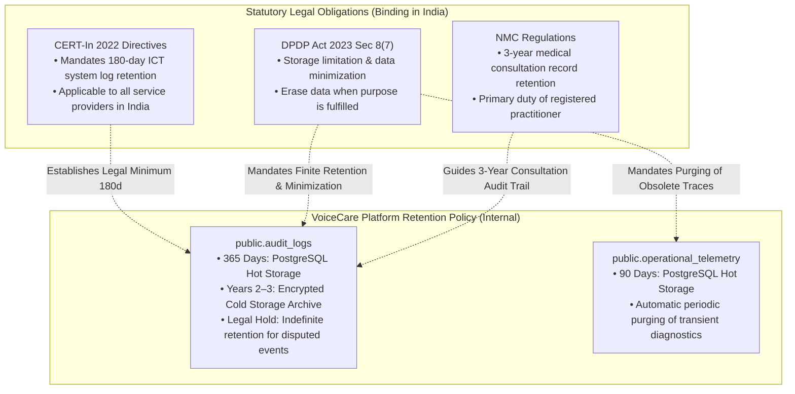

# VoiceCare Phase 2 — Part 6: Audit Logging, Telemetry and Compliance Notes

**Document:** Security Analysis, Threat Model, Implementation Deep-Dive & Compliance Rationale  
**Status:** APPROVED TECHNICAL NOTES — NOT YET EXECUTED IN SUPABASE  
**Scope:** Part 6 Audit Architecture, Telemetry Ingestion, Trigger Interception & Privacy Guards  

---

## 1. Technical Rationale & Implementation Deep-Dive

### 1.1 Non-Intrusive Event Capture via Database Triggers
A fundamental architectural objective in Part 6 was to establish comprehensive audit logging across all critical actions without modifying, monkey-patching, or destabilizing the previously reviewed and approved Parts 1–5 SQL migrations:
- **How Triggers Achieve This:**
  By creating `AFTER INSERT OR UPDATE` triggers on `public.doctor_verifications`, `public.appointments`, `public.doctor_documents`, and `public.profiles`, all state changes are intercepted at the database engine level.
  - Whether a doctor application is submitted via `submit_doctor_application()` (Part 4) or approved via `admin_review_doctor_application()` (Part 5), the trigger fires automatically within the same atomic transaction.
  - If any unexpected or un-audited direct update were attempted, the trigger guarantees that an audit record is emitted.
  - If the parent transaction rolls back due to a validation error or constraint violation, the associated audit entry rolls back atomically, preventing phantom audit entries for failed operations.
- **Trigger Isolation:**
  The trigger functions execute as `SECURITY DEFINER` with `SET search_path = pg_catalog`, invoking the internal sanitizer `record_audit_log_internal()`. They do not interfere with existing triggers (`sync_doctor_approval`, `protect_profile_role`, `protect_doctor_fields`).

---

### 1.2 Data Minimization & Privacy-by-Design Implementation
In healthcare systems, audit logs often become an inadvertent compliance hazard if they duplicate patient medical data.
- **The Threat:** When a patient books an appointment via `book_appointment()`, they submit clinical context (`chief_complaint`). If the audit trigger copied `NEW.*` into `audit_logs.event_metadata`, the audit log would store unencrypted medical symptoms, violating data minimization principles.
- **Part 6 Enforcement:**
  1. **Strict Metadata Whitelisting:** The appointment trigger explicitly constructs its metadata JSON payload:
     ```sql
     jsonb_build_object(
         'doctor_id', NEW.doctor_id,
         'patient_id', NEW.patient_id,
         'appointment_date', NEW.appointment_date,
         'appointment_time', NEW.appointment_time,
         'status', NEW.status
     )
     ```
     Notice that `chief_complaint`, `patient_name`, and `patient_phone` are **strictly omitted**.
  2. **Defensive Sanitization in `record_audit_log_internal`:**
     Any metadata passed to the internal audit function is stripped of sensitive keys:
     ```sql
     v_sanitized_meta := p_metadata - ARRAY[
         'token', 'jwt', 'password', 'secret', 'key', 'auth', 'bearer',
         'chief_complaint', 'symptoms', 'medical_notes', 'consultation_notes',
         'signed_url', 'view_url'
     ];
     ```
  3. **Credential Hashing:** For doctor applications, the medical registration number is hashed via `md5()` in the audit payload, verifying application identity without exposing raw license numbers in audit search indexes.

---

### 1.3 Strict Immutability & Anti-Tampering Engine
Audit trails are legally useless if an administrator or attacker can edit, overwrite, or delete historical entries to conceal unauthorized actions.
- **Engine-Level Blockers:**
  Part 6 attaches `BEFORE UPDATE OR DELETE` triggers to both `public.audit_logs` and `public.operational_telemetry`.
  ```sql
  CREATE OR REPLACE FUNCTION public.prevent_audit_log_tampering()
  RETURNS TRIGGER
  LANGUAGE plpgsql
  SECURITY DEFINER
  SET search_path = pg_catalog
  AS $$
  BEGIN
      RAISE EXCEPTION 'Audit records and telemetry entries are strictly append-only and cannot be modified or deleted (code: IMMUTABLE_AUDIT_RECORD)'
          USING ERRCODE = '42501';
      RETURN NULL;
  END;
  $$;
  ```
- **Permission Revocation:**
  `REVOKE ALL` is executed on both tables. Neither ordinary users nor administrators have direct `INSERT`, `UPDATE`, or `DELETE` SQL privileges.
- **Result:**
  Even if an administrator executes `DELETE FROM public.audit_logs WHERE id = '...'`, PostgreSQL aborts the command immediately with error `42501 IMMUTABLE_AUDIT_RECORD`.

---

### 1.4 Separation of Audit Logs and Operational Telemetry
- **`public.audit_logs`:** Represents the **legal, clinical, and administrative compliance audit trail**. High value, strictly structured, immutable, retained for 1 to 3 years.
- **`public.operational_telemetry`:** Represents **system observability and diagnostic telemetry** (e.g. storage queue retries, RPC validation errors, client error boundary captures). High frequency, transient value, purgeable after 90 days.
- Separating these tables prevents system error noise from bloating compliance audit indexes.

---

## 2. Threat Modeling & Security Mitigations

| Threat Vector | Attack Scenario | Naive System Behavior | Part 6 Mitigation Mechanism |
| :--- | :--- | :--- | :--- |
| **T1: Audit Log Tampering / Deletion** | Rogue administrator or compromised account attempts to delete audit logs after illicit access. | **VULNERABLE:** Without triggers, an admin can run `DELETE FROM audit_logs`. | **MITIGATED:** `trg_audit_logs_immutability` blocks all `UPDATE` and `DELETE` queries with `IMMUTABLE_AUDIT_RECORD`. |
| **T2: PHI Leakage into Audit Tables** | Patient symptoms and sensitive medical notes are copied into audit log payloads. | **VULNERABLE:** Logging `row_to_json(NEW)` exposes sensitive health data to anyone auditing the logs. | **MITIGATED:** Data minimization filter strips `chief_complaint`, `symptoms`, and `medical_notes`. Only non-clinical lifecycle metadata is stored. |
| **T3: Direct Client Audit Injection** | Malicious client inserts fake audit logs via the PostgREST Data API to frame another user. | **VULNERABLE:** If table allows client `INSERT`, attacker injects falsified events. | **MITIGATED:** Direct client `INSERT` is revoked. Ingestion is routed exclusively through trusted `SECURITY DEFINER` database triggers. |
| **T4: Unauthorized Audit Enumeration** | Ordinary patient or doctor inspects audit logs to track another user's activity. | **VULNERABLE:** If audit table is readable by authenticated users, private activity is leaked. | **MITIGATED:** Row Level Security policy `"audit_logs: admin read only"` restricts `SELECT` strictly to `public.is_admin() = true`. |
| **T5: Credential Leakage in Telemetry** | Client or Edge Function passes request headers containing JWTs or API keys to telemetry. | **VULNERABLE:** Storing raw telemetry payloads exposes active auth tokens in error tables. | **MITIGATED:** `record_telemetry_event` strips keys matching `token`, `jwt`, `password`, `secret`, `bearer`, and `auth`. |
| **T6: Phantom Audit Event Creation** | An RPC fails midway due to a validation error, but an audit log entry remains recorded. | **VULNERABLE:** Standalone logging out of transaction creates phantom audit entries for rejected actions. | **MITIGATED:** Automated triggers execute inside the exact same PostgreSQL transaction; an uncommitted or aborted transaction automatically rolls back the audit record. |

---

## 3. Statutory Obligations vs. Internal Platform Retention Policies

A core requirement is to clearly distinguish binding Indian legal mandates from VoiceCare internal product decisions:



### Statutory Comparison Summary:
1. **CERT-In Directions (April 2022):** Legally mandates **180 days** retention of ICT system logs. VoiceCare's 365-day hot retention fully complies with this legal minimum.
2. **DPDP Act, 2023:** Mandates that personal data not be kept longer than necessary for its processed purpose. Retaining audit records beyond necessary dispute resolution periods without legal hold would violate storage limitation principles.
3. **Internal Policy:** The distinction between 365-day hot storage and 90-day telemetry purging is an internal operational policy designed by VoiceCare to balance query performance, database storage costs, and forensic readiness.

---

## 4. Cross-Part Integration & Schema Alignment Matrix

| Dimension | Part 1: Foundation | Part 2: Auth & Roles | Part 3: Storage | Part 4: Appointment Engine | Part 5: Admin Review | Part 6: Audit & Telemetry |
| :--- | :--- | :--- | :--- | :--- | :--- | :--- |
| **Tables Created** | 9 clinical & auth tables | RLS policies & views | Storage deletion queue | Transactional RPCs | Admin decision RPCs | `audit_logs`, `operational_telemetry` |
| **Role Promotion** | `user_role` enum | `protect_profile_role` | Storage role check | Role kept as `'patient'` | Promotes to `'doctor'` | Triggers `profile_role_changed` audit event |
| **Doctor Application** | `doctor_verifications` | RLS for admin/doctor | `doctor-docs` bucket | `submit_doctor_application` | `admin_review_doctor_application` | Triggers `doctor_application_submitted` / `approved` / `rejected` |
| **Appointments** | `appointments` table | Directory views | N/A | Booking & lifecycle RPCs | N/A | Triggers `appointment_booked`, `confirmed`, `cancelled`, `completed` |
| **Documents** | `doctor_documents` | Direct INSERT revoked | Storage RLS & cleanup | 25-doc quota lock | Admin presigned URL | Triggers `doctor_document_uploaded` / `deleted` |
| **Access Rights** | Tables public | RLS enabled | Bucket private | SECURITY DEFINER | SECURITY DEFINER | SECURITY DEFINER + Admin RLS |

---

## 5. Verification Methodology & Tooling Disclosure

1. **Static Suite Verification:**
   - Target migration `voicecare_phase2_part6_audit.sql` was validated via `verify_part6_sql.py`.
   - Verified 26 balanced `$$` dollar-quote tokens (13 blocks), zero prohibited statements, zero secrets, 11 hardened functions, 4 admin authorization guards, dual immutability triggers, data minimization exclusion rules, 6 preflight assertions, and post-migration validation assertions.
2. **PostgreSQL C-Grammar AST Parser Availability:**
   - Neither a dedicated PostgreSQL C-grammar AST parser (such as `pglast`) nor a live local PostgreSQL / Supabase CLI test environment (`psql` / Docker) is installed or accessible in this execution environment.
3. **Execution Status:**
   - **Verified:** Syntactic quote balancing, DDL and RPC structure, immutability triggers, data minimization filters, secret absence, and authorization guards.
   - **Unverified by Live Execution:** Live database transaction isolation and Supabase Auth JWT decoding at runtime were not executed, as no live Supabase connection was authorized.
