# VoiceCare Phase 2 — Migration Dependency and Execution Guide

## 1. Executive Summary

This guide provides the definitive operational blueprint for executing the **VoiceCare Phase 2 Database Migrations** across staging, testing, and production environments on **Supabase PostgreSQL 15+**.

Phase 2 establishes the entire backend data architecture, role-based access control (RBAC), private medical document storage, appointment scheduling engine, administrative review dashboard, and tamper-resistant audit logging foundation for VoiceCare.

> [!WARNING]
> **REVIEW ARTIFACTS ONLY — DO NOT EXECUTE DIRECTLY IN PRODUCTION**
> All SQL files in this repository represent reviewed, static-verified specifications. No migration has been executed against live production databases. All migrations must first be executed and validated in an isolated staging sandbox.

---

## 2. Dependency Architecture & Execution DAG

The migration sequence is strictly ordered according to database object dependencies:

```mermaid
flowchart TD
    subgraph Part1["Part 1: Core Foundation"]
        T1["Custom Types & Enums<br/>• user_role<br/>• verification_status<br/>• appointment_status<br/>• medical_specialty"]
        T2["Core Relational Tables (9)<br/>• profiles, patients, doctors<br/>• doctor_verifications, doctor_documents<br/>• doctor_schedules, doctor_leaves<br/>• appointments, in_app_reminders"]
        T3["Constraints & GiST Exclusions<br/>• Phone regex: ^[6-9][0-9]{9}$<br/>• Age magnitude & units<br/>• Dual GiST overlap exclusions"]
    end

    subgraph Part2["Part 2: Auth, Roles & Base RLS"]
        A1["Auth Lifecycle Automation<br/>• handle_new_user() on auth.users<br/>• Default role = 'patient'"]
        A2["RBAC & Field Protection Triggers<br/>• protect_profile_role()<br/>• protect_doctor_fields()<br/>• sync_doctor_approval()"]
        A3["Public Directory Views<br/>• public_doctor_directory<br/>• public_doctor_schedules<br/>• public_doctor_leaves"]
        A4["Row Level Security Enablement<br/>• 19 RLS policies across 9 tables<br/>• Least-privilege base grants"]
    end

    subgraph Part3["Part 3: Private Storage & Queue"]
        S1["Storage Bucket Setup<br/>• private 'doctor-docs' bucket<br/>• 10MB limit, strict MIME whitelist"]
        S2["Storage RLS Policies (4)<br/>• Folder isolation: {doctor_id}/*<br/>• is_doctor_document_owner()"]
        S3["Storage Deletion Queue<br/>• storage_deletion_queue table<br/>• enqueue trigger on document delete"]
    end

    subgraph Part4["Part 4: Appointment Engine & RPCs"]
        E1["Doctor Onboarding RPCs<br/>• submit_doctor_application()<br/>• register_doctor_document()<br/>• 25-doc quota lock & REVOKE INSERT"]
        E2["Patient Booking & Lifecycle RPCs<br/>• complete_patient_onboarding()<br/>• book_appointment()<br/>• reschedule_appointment()<br/>• cancel_appointment() / patient_cancel_appointment()<br/>• doctor_respond_appointment()<br/>• doctor_close_appointment()<br/>• dismiss_reminder()"]
    end

    subgraph Part5["Part 5: Admin Review Dashboard"]
        R1["Admin Adjudication RPCs<br/>• admin_review_doctor_application()<br/>• State machine & role promotion<br/>• Row-locking on doctor_verifications"]
        R2["Admin Analytics & Listing RPCs<br/>• admin_list_doctor_applications()<br/>• admin_get_doctor_application_details()<br/>• admin_get_application_stats()"]
    end

    subgraph Part6["Part 6: Audit Logging & Telemetry"]
        L1["Append-Only Immutability Engine<br/>• audit_logs & operational_telemetry<br/>• BEFORE UPDATE/DELETE triggers<br/>• IMMUTABLE_AUDIT_RECORD code"]
        L2["Automated Lifecycle Audit Triggers<br/>• trg_audit_doctor_verifications<br/>• trg_audit_appointments<br/>• trg_audit_doctor_documents<br/>• trg_audit_profile_role"]
        L3["Telemetry & Admin Query RPCs<br/>• record_telemetry_event()<br/>• admin_list_audit_logs()<br/>• admin_get_audit_stats()<br/>• admin_list_telemetry_events()<br/>• admin_get_telemetry_summary()"]
    end

    subgraph Part7["Part 7: Consolidated Orchestrator"]
        C1["voicecare_phase2_consolidated_migration.sql<br/>• Single atomic transaction: BEGIN ... COMMIT<br/>• Post-migration DO $$ verification block"]
    end

    T1 --> T2 --> T3
    T3 --> A1 --> A2 --> A3 --> A4
    A4 --> S1 --> S2 --> S3
    S3 --> E1 --> E2
    E2 --> R1 --> R2
    R2 --> L1 --> L2 --> L3
    L3 --> C1
```

---

## 3. Execution Strategies

VoiceCare supports two distinct execution paths depending on deployment tooling:

### Strategy A: Single-Pass Consolidated Migration (Recommended)
- **Target File:** `docs/phase-2/part-7-integrated-migration/voicecare_phase2_consolidated_migration.sql`
- **Mechanism:** Executes all 6 parts inside a single atomic `BEGIN ... COMMIT;` transaction block.
- **Benefits:**
  - Guaranteed atomicity: If any step fails, PostgreSQL automatically rolls back all preceding statements, leaving zero orphaned tables or broken triggers.
  - Simplified execution via Supabase SQL Editor or Supabase CLI.
  - Embedded master post-migration integrity verification block (`DO $$ ... $$`) asserts that all 12 tables, 4 enums, 3 views, 39 functions, 13 triggers, and 26 RLS policies are operational before committing.

### Strategy B: Phased Step-by-Step Modular Migration
- **Target Files:**
  1. `docs/phase-2/part-1-database-foundation/voicecare_part1_database.sql`
  2. `docs/phase-2/part-2-authentication-roles/voicecare_part2_auth.sql`
  3. `docs/phase-2/part-3-storage-verification/voicecare_phase2_part3_storage.sql`
  4. `docs/phase-2/part-4-appointment-engine/voicecare_phase2_part4_rpc.sql`
  5. `docs/phase-2/part-5-admin-review/voicecare_phase2_part5_admin_review.sql`
  6. `docs/phase-2/part-6-audit-telemetry/voicecare_phase2_part6_audit.sql`
- **Mechanism:** Run each part sequentially. Each part features its own preflight assertions verifying that the preceding part has been successfully committed.

---

## 4. Idempotency & Safe Re-Execution Rules

All DDL and DML statements in Phase 2 are authored with safe re-execution semantics:

| Object Category | Idempotent Syntax Employed | Failure Prevention Behavior |
| :--- | :--- | :--- |
| **Enum Types** | `DO $$ BEGIN CREATE TYPE ... EXCEPTION WHEN duplicate_object THEN null; END $$;` | Skips creation without error if enum already exists. |
| **Relational Tables** | `CREATE TABLE IF NOT EXISTS public.<table_name> (...)` | Preserves existing tables and schemas. |
| **Constraints** | `ALTER TABLE ... DROP CONSTRAINT IF EXISTS ...; ALTER TABLE ... ADD CONSTRAINT ...` | Avoids duplicate constraint registration errors. |
| **Indexes** | `CREATE INDEX IF NOT EXISTS <index_name> ON ...` | Avoids index collision errors. |
| **Functions** | `CREATE OR REPLACE FUNCTION public.<func_name> (...)` | Overwrites function bodies with latest hardened definitions. |
| **Triggers** | `DROP TRIGGER IF EXISTS <trg_name> ON ...; CREATE TRIGGER ...` | Seamlessly updates trigger bindings without collisions. |
| **RLS Policies** | `DROP POLICY IF EXISTS "<pol_name>" ON ...; CREATE POLICY ...` | Replaces policies cleanly without "policy already exists" aborts. |
| **Storage Buckets** | `INSERT INTO storage.buckets (...) ON CONFLICT (id) DO UPDATE ...` | Updates bucket configuration (file size limit, MIME types) idempotently. |

---

## 5. Rollback Strategies & Failure Recovery

Because PostgreSQL supports **transactional DDL**, executing via Strategy A provides automated rollback:

1. **Automatic Transaction Rollback:**
   - Any runtime failure (syntax error, type conflict, or missing extension) immediately aborts the active transaction block.
   - The database returns to the exact state it was in prior to `BEGIN;`.
2. **Post-Commit Failure Remediation:**
   - If an issue is discovered after successful commit, execute the inverse teardown script in reverse dependency order:
     1. Drop Part 6 triggers and tables (`audit_logs`, `operational_telemetry`).
     2. Drop Part 5 admin review RPCs.
     3. Drop Part 4 appointment engine and onboarding RPCs.
     4. Drop Part 3 storage deletion queue, triggers, and storage policies.
     5. Drop Part 2 auth triggers, views, and RLS policies.
     6. Drop Part 1 core tables, constraints, and custom types.
3. **Data Loss Prevention:**
   - **Never drop tables containing production data** without performing an encrypted `pg_dump` backup first.

---

## 6. Preflight Environment Checklist

Before triggering migrations in Supabase:
- [ ] Supabase project PostgreSQL version verified to be **15.0 or higher** (`SELECT version();`).
- [ ] Schema `auth` exists and is managed by Supabase Auth (`SELECT schema_name FROM information_schema.schemata WHERE schema_name = 'auth';`).
- [ ] Schema `storage` exists with `storage.buckets` and `storage.objects` (`SELECT table_name FROM information_schema.tables WHERE table_schema = 'storage';`).
- [ ] Extension `btree_gist` enabled for dual overlap exclusion constraints (`CREATE EXTENSION IF NOT EXISTS btree_gist;`).
- [ ] Master database role (`postgres`) credentials available for migration execution.
